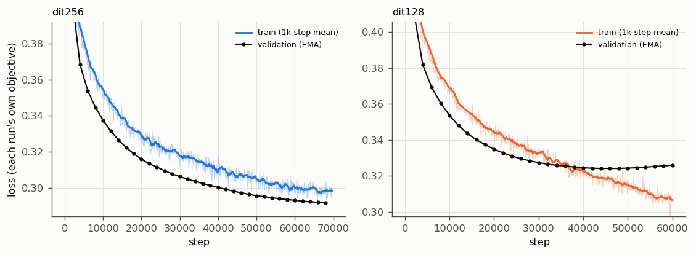
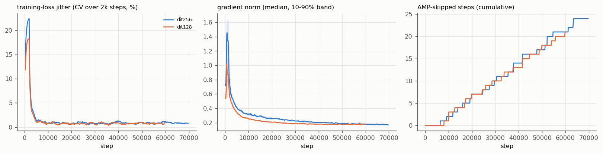
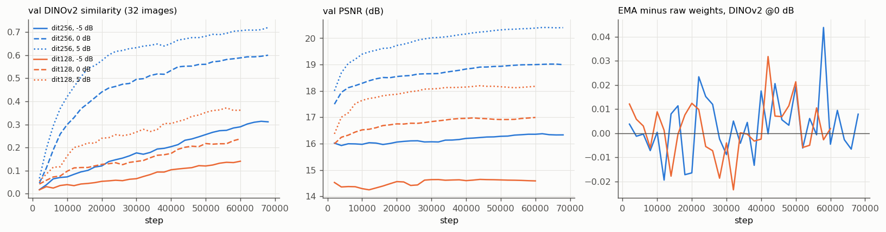
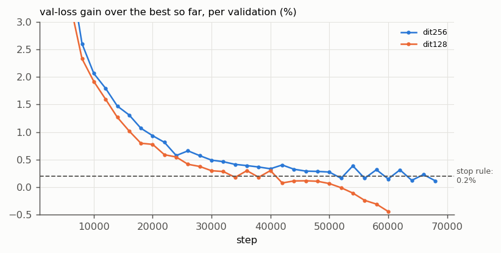
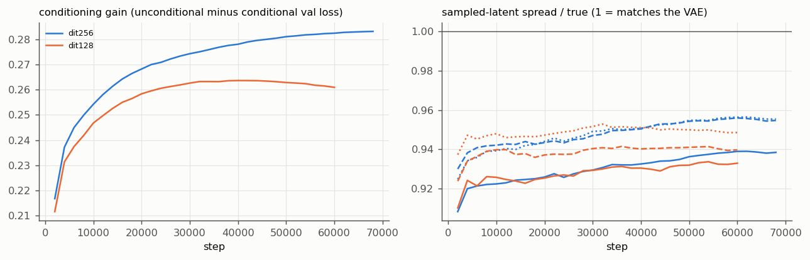
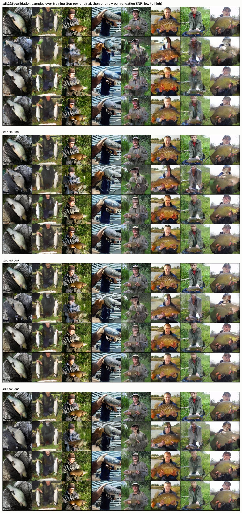
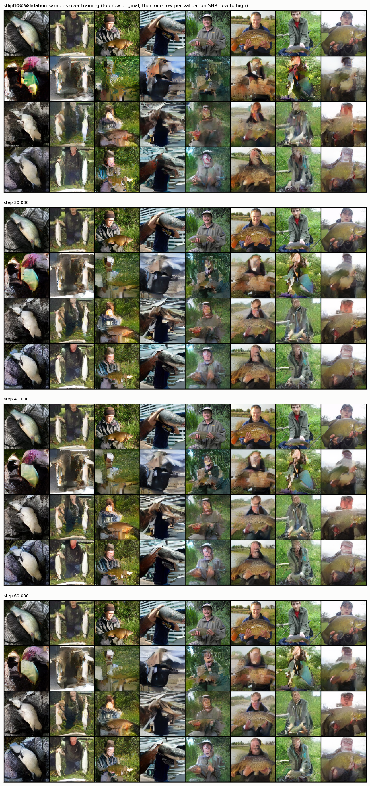

# Training analysis

Training loss is logged every 100 steps (mean over those steps); validation uses the EMA weights: loss on the validation split, quality on 32 fixed validation images (noisy: compare trends, not single points). Loss jitter = standard deviation / mean of the logged training loss over 2k-step windows.

| Run | Steps | State | Best val loss (step) | Last val loss | Validations since best | Loss jitter, last 10k | Grad norm, last 10k | AMP-skipped | Val DINOv2 @0 dB (best / last) |
|---|---|---|---|---|---|---|---|---|---|
| dit256 | 69,700 | running | 0.2915 (68,000) | 0.2915 | 1 of 10 | 0.9% | 0.176 | 24 | 0.600 / 0.600 |
| dit128 | 60,000 | finished, converged | 0.3242 (46,000) | 0.3260 | 10 of 10 | 1.1% | 0.179 | 21 | 0.206 / 0.238 |

Line style is the SNR (solid / dashed / dotted = -5 / 0 / 5 dB). Above zero in the right panel, the EMA weights the run is evaluated with beat its raw weights.

A run stops once `patience` validations in a row stay under the dashed line (no gain above 0.2% over its best). Points near the line mean it is still improving slowly.

