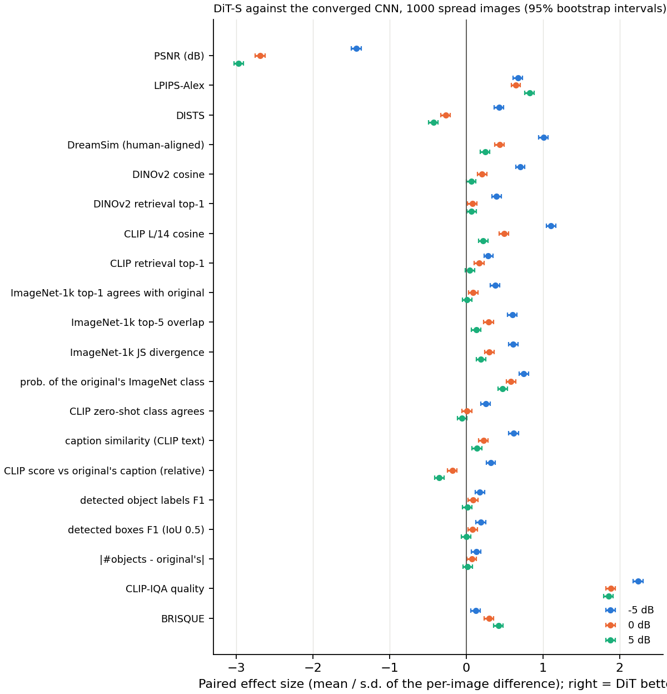

# What the DiT does better than the converged CNN (exploratory)

Protocol fixed before computing (month plan, 22 Nov). Positive differences favour the DiT. A metric
counts as a DiT advantage only if its paired 95% interval favours the DiT on both the exploration
(even) and confirmation (odd) halves at 0 and +5 dB.

| metric | group | -5 dB: DiT / CNN, diff [95%], win rate | 0 dB: DiT / CNN, diff [95%], win rate | 5 dB: DiT / CNN, diff [95%], win rate | verdict |
|---|---|---|---|---|---|
| PSNR (dB) | pixel | 16.891 / 18.462, -1.572 [-1.641, -1.503], 5% | 19.379 / 21.288, -1.909 [-1.954, -1.865], 1% | 20.698 / 22.787, -2.089 [-2.134, -2.046], 1% | CNN advantage (confirmed) |
| LPIPS-Alex | perceptual | 0.363 / 0.402, +0.039 [+0.035, +0.042], 77% | 0.258 / 0.288, +0.031 [+0.028, +0.033], 80% | 0.207 / 0.246, +0.039 [+0.036, +0.042], 85% | DiT advantage (confirmed) |
| DISTS | perceptual | 0.254 / 0.266, +0.012 [+0.010, +0.014], 66% | 0.206 / 0.200, -0.006 [-0.007, -0.005], 40% | 0.181 / 0.172, -0.009 [-0.010, -0.008], 30% | CNN advantage (confirmed) |
| DreamSim (human-aligned) | perceptual | 0.334 / 0.432, +0.098 [+0.092, +0.104], 84% | 0.211 / 0.234, +0.024 [+0.020, +0.027], 68% | 0.162 / 0.172, +0.011 [+0.008, +0.013], 59% | DiT advantage (confirmed) |
| DINOv2 cosine | semantic | 0.431 / 0.297, +0.134 [+0.123, +0.146], 77% | 0.635 / 0.604, +0.031 [+0.022, +0.040], 61% | 0.728 / 0.720, +0.008 [+0.001, +0.016], 58% | mixed / tie |
| DINOv2 retrieval top-1 | semantic | 0.484 / 0.254, +0.230 [+0.193, +0.266], 31% | 0.860 / 0.826, +0.034 [+0.007, +0.060], 11% | 0.959 / 0.941, +0.018 [+0.002, +0.035], 4% | mixed / tie |
| CLIP L/14 cosine | semantic | 0.705 / 0.623, +0.082 [+0.078, +0.087], 89% | 0.766 / 0.729, +0.036 [+0.032, +0.041], 68% | 0.801 / 0.785, +0.015 [+0.011, +0.020], 61% | DiT advantage (confirmed) |
| CLIP retrieval top-1 | semantic | 0.089 / 0.011, +0.078 [+0.063, +0.096], 8% | 0.234 / 0.158, +0.076 [+0.047, +0.104], 14% | 0.391 / 0.367, +0.024 [-0.008, +0.057], 15% | mixed / tie |
| ImageNet-1k top-1 agrees with original | semantic | 0.669 / 0.464, +0.205 [+0.171, +0.238], 27% | 0.832 / 0.794, +0.038 [+0.013, +0.063], 10% | 0.883 / 0.880, +0.003 [-0.017, +0.024], 6% | mixed / tie |
| ImageNet-1k top-5 overlap | semantic | 0.471 / 0.311, +0.160 [+0.143, +0.176], 57% | 0.618 / 0.546, +0.072 [+0.057, +0.087], 43% | 0.672 / 0.642, +0.030 [+0.015, +0.043], 32% | DiT advantage (confirmed) |
| ImageNet-1k JS divergence | semantic | 0.163 / 0.284, +0.120 [+0.108, +0.132], 78% | 0.072 / 0.113, +0.041 [+0.032, +0.049], 76% | 0.045 / 0.062, +0.017 [+0.012, +0.023], 74% | DiT advantage (confirmed) |
| prob. of the original's ImageNet class | semantic | 0.463 / 0.235, +0.228 [+0.209, +0.247], 79% | 0.618 / 0.474, +0.143 [+0.128, +0.158], 78% | 0.660 / 0.570, +0.090 [+0.079, +0.102], 76% | DiT advantage (confirmed) |
| CLIP zero-shot class agrees | semantic | 0.299 / 0.171, +0.128 [+0.097, +0.159], 20% | 0.490 / 0.485, +0.005 [-0.028, +0.038], 14% | 0.601 / 0.628, -0.027 [-0.058, +0.004], 11% | mixed / tie |
| caption similarity (CLIP text) | language | 0.744 / 0.657, +0.087 [+0.079, +0.096], 73% | 0.812 / 0.782, +0.030 [+0.022, +0.039], 53% | 0.841 / 0.826, +0.016 [+0.009, +0.023], 50% | DiT advantage (confirmed) |
| CLIP score vs original's caption (relative) | language | 0.895 / 0.851, +0.044 [+0.035, +0.051], 61% | 0.966 / 0.988, -0.022 [-0.029, -0.014], 42% | 0.993 / 1.030, -0.037 [-0.044, -0.031], 37% | CNN advantage (confirmed) |
| detected object labels F1 | objects | 0.361 / 0.278, +0.082 [+0.055, +0.111], 34% | 0.442 / 0.400, +0.042 [+0.012, +0.070], 30% | 0.471 / 0.465, +0.006 [-0.020, +0.033], 28% | mixed / tie |
| detected boxes F1 (IoU 0.5) | objects | 0.316 / 0.232, +0.084 [+0.056, +0.113], 32% | 0.395 / 0.359, +0.037 [+0.011, +0.064], 30% | 0.432 / 0.433, -0.000 [-0.025, +0.026], 27% | mixed / tie |
| |#objects - original's| | objects | 1.740 / 1.927, +0.187 [+0.099, +0.272], 35% | 1.514 / 1.611, +0.097 [+0.015, +0.185], 30% | 1.453 / 1.476, +0.023 [-0.061, +0.112], 30% | mixed / tie |
| CLIP-IQA quality | no-reference | 0.797 / 0.321, +0.475 [+0.462, +0.488], 98% | 0.822 / 0.433, +0.390 [+0.376, +0.403], 97% | 0.829 / 0.463, +0.366 [+0.354, +0.378], 98% | DiT advantage (confirmed) |
| BRISQUE | no-reference | 22.077 / 23.752, +1.675 [+0.821, +2.527], 56% | 21.466 / 25.404, +3.938 [+3.126, +4.739], 66% | 21.228 / 26.436, +5.209 [+4.423, +5.928], 70% | DiT advantage (confirmed) |

## Distribution (precision = realism, recall / coverage = diversity of the outputs)

| SNR | system | DINOv2 P / R / D / C | CLIP P / R / D / C |
|---|---|---|---|
| -5 | dit | 0.499 / 0.534 / 0.184 / 0.289 | 0.599 / 0.088 / 0.263 / 0.130 |
| -5 | cnn | 0.359 / 0.268 / 0.106 / 0.125 | 0.236 / 0.003 / 0.141 / 0.037 |
| 0 | dit | 0.724 / 0.864 / 0.386 / 0.669 | 0.621 / 0.237 / 0.323 / 0.342 |
| 0 | cnn | 0.686 / 0.745 / 0.315 / 0.558 | 0.410 / 0.106 / 0.228 / 0.208 |
| 5 | dit | 0.862 / 0.980 / 0.538 / 0.863 | 0.663 / 0.406 / 0.359 / 0.513 |
| 5 | cnn | 0.846 / 0.937 / 0.477 / 0.798 | 0.549 / 0.198 / 0.296 / 0.387 |

## Content: on which originals does the DiT gain? (Spearman of the per-image gain with the property;
mean gain in the lowest and highest quartile of the property)

**-5 dB**

| metric | edge density | high-frequency energy | colourfulness | best classes for the DiT | worst |
|---|---|---|---|---|---|
| dreamsim | r = -0.00, +0.092 -> +0.090 | r = -0.01, +0.091 -> +0.088 | r = +0.01, +0.087 -> +0.096 | tench, English springer, golf ball | gas pump, chain saw, cassette player |
| dino_sim | r = -0.02, +0.146 -> +0.127 | r = -0.02, +0.135 -> +0.125 | r = +0.01, +0.114 -> +0.134 | parachute, tench, English springer | church, chain saw, cassette player |
| clip_sim | r = -0.08, +0.087 -> +0.071 | r = -0.10, +0.088 -> +0.065 | r = +0.11, +0.066 -> +0.091 | tench, parachute, church | gas pump, chain saw, cassette player |
| lpips | r = +0.06, +0.032 -> +0.045 | r = +0.03, +0.034 -> +0.042 | r = +0.11, +0.030 -> +0.048 | golf ball, parachute, garbage truck | French horn, cassette player, chain saw |
| caption_sim | r = -0.01, +0.083 -> +0.087 | r = +0.00, +0.082 -> +0.086 | r = -0.03, +0.076 -> +0.073 | tench, golf ball, English springer | cassette player, church, gas pump |
| psnr | r = -0.16, -1.241 -> -1.694 | r = -0.16, -1.272 -> -1.750 | r = +0.12, -1.661 -> -1.329 | golf ball, parachute, tench | chain saw, gas pump, French horn |

**0 dB**

| metric | edge density | high-frequency energy | colourfulness | best classes for the DiT | worst |
|---|---|---|---|---|---|
| dreamsim | r = +0.10, +0.022 -> +0.029 | r = +0.06, +0.019 -> +0.027 | r = +0.03, +0.015 -> +0.022 | English springer, tench, French horn | parachute, gas pump, cassette player |
| dino_sim | r = -0.02, +0.044 -> +0.034 | r = -0.01, +0.028 -> +0.030 | r = +0.02, +0.016 -> +0.024 | English springer, parachute, tench | French horn, gas pump, cassette player |
| clip_sim | r = -0.03, +0.041 -> +0.034 | r = -0.04, +0.039 -> +0.032 | r = +0.14, +0.017 -> +0.053 | church, parachute, English springer | chain saw, gas pump, cassette player |
| lpips | r = +0.28, +0.012 -> +0.050 | r = +0.22, +0.013 -> +0.043 | r = +0.10, +0.023 -> +0.035 | English springer, church, garbage truck | tench, chain saw, cassette player |
| caption_sim | r = +0.04, +0.026 -> +0.033 | r = +0.01, +0.032 -> +0.039 | r = +0.06, +0.027 -> +0.037 | tench, parachute, church | chain saw, gas pump, cassette player |
| psnr | r = -0.13, -1.739 -> -1.975 | r = -0.16, -1.707 -> -2.014 | r = +0.16, -2.037 -> -1.782 | golf ball, parachute, tench | chain saw, gas pump, French horn |

**5 dB**

| metric | edge density | high-frequency energy | colourfulness | best classes for the DiT | worst |
|---|---|---|---|---|---|
| dreamsim | r = +0.19, +0.002 -> +0.021 | r = +0.15, +0.002 -> +0.016 | r = +0.08, +0.004 -> +0.014 | English springer, tench, French horn | golf ball, gas pump, cassette player |
| dino_sim | r = +0.01, +0.008 -> +0.016 | r = +0.00, +0.003 -> +0.010 | r = +0.05, -0.007 -> +0.013 | English springer, tench, parachute | French horn, gas pump, cassette player |
| clip_sim | r = +0.04, +0.016 -> +0.020 | r = +0.02, +0.016 -> +0.016 | r = +0.15, +0.003 -> +0.035 | church, English springer, parachute | chain saw, cassette player, gas pump |
| lpips | r = +0.43, +0.014 -> +0.065 | r = +0.31, +0.015 -> +0.054 | r = +0.07, +0.031 -> +0.040 | English springer, church, gas pump | parachute, chain saw, cassette player |
| caption_sim | r = +0.10, +0.009 -> +0.036 | r = +0.07, +0.007 -> +0.022 | r = +0.00, +0.007 -> +0.012 | tench, church, chain saw | gas pump, golf ball, cassette player |
| psnr | r = -0.09, -1.954 -> -2.150 | r = -0.11, -1.962 -> -2.190 | r = +0.18, -2.235 -> -1.952 | golf ball, tench, parachute | garbage truck, chain saw, French horn |

## Captions where the two systems disagree most (0 dB)

**dit_better**

- [church] original: *there is a large building with a clock on the front of it* | DiT: *there is a large building with a clock tower in the middle of a town* (0.93) | CNN: *painting of a church at night with a horse and carriage in the foreground* (0.35)
- [gas pump] original: *there is a yellow gas pump sitting in front of a gas station* | DiT: *there is a yellow gas pump sitting on the side of the road* (0.91) | CNN: *painting of a clock tower with a flag flying in the background* (0.36)
- [parachute] original: *there is a picture of a person parasailing in the sky* | DiT: *there is a picture of a person parasailing in the sky* (1.00) | CNN: *there is a picture of a picture of a computer mouse on a wall* (0.53)
- [tench] original: *there is a man kneeling in the grass holding a fish* | DiT: *there is a man kneeling in the grass holding a fish* (1.00) | CNN: *there is a blurry photo of a woman sitting on a bench* (0.53)
- [chain saw] original: *there is a chainsaw that is sitting on a log in the woods* | DiT: *there is a chainsaw sitting on top of a log in the woods* (0.96) | CNN: *painting of a man sitting on a dirt bike with a wooden spoon in his hand* (0.49)
- [golf ball] original: *there is a red golf ball on a green surface with a tree in the background* | DiT: *there is a red ball sitting on a green surface with a tree in the background* (0.92) | CNN: *there is a blurry image of a person throwing a ball* (0.51)
- [parachute] original: *there is a man that is standing in the grass with a parachute* | DiT: *there is a man that is standing in the grass with a kite* (0.90) | CNN: *there is a blurry photo of a baseball player holding a bat* (0.49)
- [French horn] original: *there is a man that is holding a french horn in his hand* | DiT: *there is a man that is holding a french horn in his hand* (1.00) | CNN: *painting of a man in a red shirt holding a french horn* (0.60)

**cnn_better**

- [chain saw] original: *a chainsaw with a chain attached to it ' s handle* | DiT: *there is a black and white cat holding a yellow toothbrush in its mouth* (0.44) | CNN: *there is a close up of a chainsaw with a chain attached to it* (0.93)
- [gas pump] original: *this is an image of a gas pump with a sign on it* | DiT: *there is a vending machine that has a roll of toilet paper on it* (0.54) | CNN: *this is an image of a gas pump at a gas station* (0.92)
- [gas pump] original: *there is a rusted gas pump sitting in front of a gas station* | DiT: *there is a white building with a sign and a street light* (0.46) | CNN: *there is an old gas pump sitting in the middle of a field* (0.83)
- [French horn] original: *there is a close up of a brass instrument on a black background* | DiT: *there is a person holding a gold french horn in their hand* (0.64) | CNN: *there is a close up of a brass instrument with a black background* (0.98)
- [church] original: *there is a very tall tower with a clock at the top of it* | DiT: *painting of a church steeple against a cloudy sky with trees in the foreground* (0.45) | CNN: *there is a painting of a church steeple with a clock on it* (0.78)
- [chain saw] original: *there is a woman that is cutting a pumpkin with a chainsaw* | DiT: *there is a man that is standing in front of a table with food on it* (0.50) | CNN: *there is a man that is cutting a large pumpkin on a table* (0.83)
- [English springer] original: *there is a dog that is sitting next to a trophy* | DiT: *there is a black and white dog sitting on a chair with a martini glass* (0.68) | CNN: *there is a dog that is sitting next to a trophy* (1.00)
- [chain saw] original: *there is a man that is cutting a tree with a chainsaw* | DiT: *there is a man that is cooking something on the fire* (0.70) | CNN: *there is a man that is cutting a tree with a chainsaw* (1.00)

**random**

- [English springer] original: *there are two dogs playing with each other in a cardboard box* | DiT: *there are two dogs that are playing with each other in a box* (0.95) | CNN: *there are two dogs that are laying down together on the floor* (0.75)
- [English springer] original: *there are five puppies laying on a brick wall in the grass* | DiT: *there are four dogs that are laying down on a brick wall* (0.91) | CNN: *there are four puppies laying on top of a brick wall* (0.92)
- [English springer] original: *there is a brown and white dog playing with a ball in the grass* | DiT: *there is a dog that is standing in the grass with a frisbee* (0.83) | CNN: *there are two dogs playing with a frisbee in the grass* (0.85)
- [garbage truck] original: *there is a garbage truck that is parked on the side of the road* | DiT: *there is a garbage truck that is parked in the grass* (0.88) | CNN: *there is a truck that is parked on the side of the road* (0.92)
- [church] original: *there is a picture of a cemetery with a church in the background* | DiT: *there is a picture of a stone church with a steeple on top of it* (0.79) | CNN: *there is a painting of a building with a clock on the top of it* (0.62)
- [church] original: *there is a very tall building with a clock on the top of it* | DiT: *there is a very tall building that has a clock on the top of it* (0.98) | CNN: *this is an image of a large cathedral with a clock on it* (0.80)
