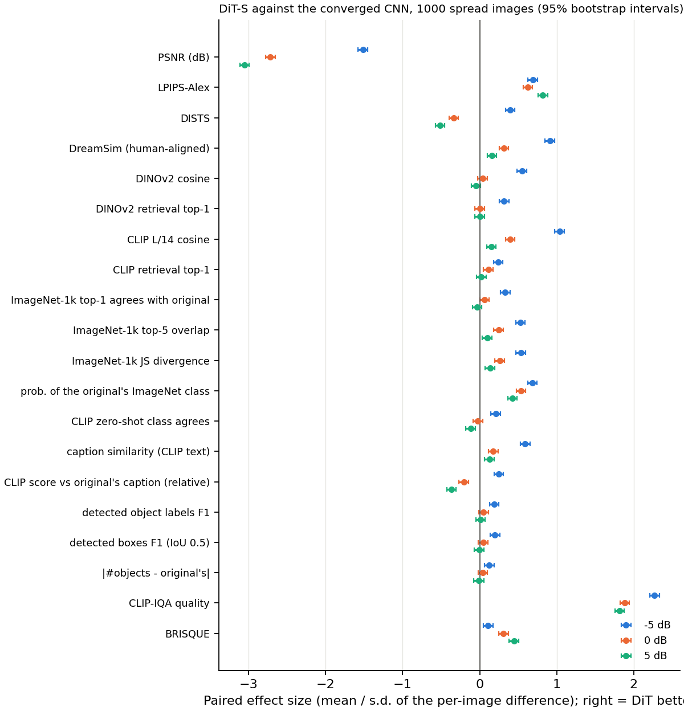

# What the DiT does better than the converged CNN (exploratory)

Protocol fixed before computing (month plan, 22 Nov). Positive differences favour the DiT. A metric
counts as a DiT advantage only if its paired 95% interval favours the DiT on both the exploration
(even) and confirmation (odd) halves at 0 and +5 dB.

| metric | group | -5 dB: DiT / CNN, diff [95%], win rate | 0 dB: DiT / CNN, diff [95%], win rate | 5 dB: DiT / CNN, diff [95%], win rate | verdict |
|---|---|---|---|---|---|
| PSNR (dB) | pixel | 16.890 / 18.462, -1.572 [-1.637, -1.504], 6% | 19.336 / 21.288, -1.952 [-1.998, -1.907], 1% | 20.698 / 22.787, -2.089 [-2.131, -2.046], 1% | CNN advantage (confirmed) |
| LPIPS-Alex | perceptual | 0.364 / 0.402, +0.038 [+0.035, +0.042], 78% | 0.259 / 0.288, +0.029 [+0.027, +0.032], 79% | 0.209 / 0.246, +0.037 [+0.034, +0.040], 85% | DiT advantage (confirmed) |
| DISTS | perceptual | 0.255 / 0.266, +0.011 [+0.009, +0.013], 66% | 0.208 / 0.200, -0.008 [-0.009, -0.006], 37% | 0.183 / 0.172, -0.011 [-0.012, -0.009], 29% | CNN advantage (confirmed) |
| DreamSim (human-aligned) | perceptual | 0.344 / 0.432, +0.087 [+0.081, +0.093], 83% | 0.217 / 0.234, +0.017 [+0.014, +0.020], 62% | 0.166 / 0.172, +0.007 [+0.004, +0.009], 55% | DiT advantage (confirmed) |
| DINOv2 cosine | semantic | 0.403 / 0.297, +0.106 [+0.094, +0.118], 73% | 0.610 / 0.604, +0.006 [-0.004, +0.016], 56% | 0.713 / 0.720, -0.006 [-0.014, +0.002], 53% | mixed / tie |
| DINOv2 retrieval top-1 | semantic | 0.439 / 0.254, +0.185 [+0.149, +0.223], 28% | 0.826 / 0.826, +0.000 [-0.028, +0.030], 11% | 0.941 / 0.941, +0.000 [-0.017, +0.017], 4% | mixed / tie |
| CLIP L/14 cosine | semantic | 0.698 / 0.623, +0.075 [+0.070, +0.079], 87% | 0.758 / 0.729, +0.029 [+0.025, +0.034], 65% | 0.796 / 0.785, +0.010 [+0.006, +0.015], 57% | DiT advantage (confirmed) |
| CLIP retrieval top-1 | semantic | 0.068 / 0.011, +0.057 [+0.043, +0.072], 6% | 0.206 / 0.158, +0.048 [+0.019, +0.075], 12% | 0.378 / 0.367, +0.011 [-0.020, +0.044], 14% | mixed / tie |
| ImageNet-1k top-1 agrees with original | semantic | 0.643 / 0.464, +0.179 [+0.146, +0.212], 25% | 0.821 / 0.794, +0.027 [+0.000, +0.052], 10% | 0.868 / 0.880, -0.012 [-0.033, +0.009], 5% | mixed / tie |
| ImageNet-1k top-5 overlap | semantic | 0.453 / 0.311, +0.142 [+0.126, +0.158], 55% | 0.608 / 0.546, +0.062 [+0.046, +0.077], 42% | 0.664 / 0.642, +0.022 [+0.008, +0.036], 31% | DiT advantage (confirmed) |
| ImageNet-1k JS divergence | semantic | 0.178 / 0.284, +0.106 [+0.093, +0.117], 75% | 0.078 / 0.113, +0.035 [+0.027, +0.043], 75% | 0.049 / 0.062, +0.013 [+0.007, +0.019], 72% | DiT advantage (confirmed) |
| prob. of the original's ImageNet class | semantic | 0.443 / 0.235, +0.208 [+0.189, +0.226], 77% | 0.606 / 0.474, +0.132 [+0.116, +0.147], 77% | 0.653 / 0.570, +0.083 [+0.071, +0.095], 74% | DiT advantage (confirmed) |
| CLIP zero-shot class agrees | semantic | 0.274 / 0.171, +0.103 [+0.072, +0.134], 18% | 0.471 / 0.485, -0.014 [-0.046, +0.020], 13% | 0.569 / 0.628, -0.059 [-0.091, -0.028], 10% | mixed / tie |
| caption similarity (CLIP text) | language | 0.742 / 0.657, +0.084 [+0.076, +0.093], 72% | 0.805 / 0.782, +0.023 [+0.015, +0.032], 52% | 0.840 / 0.826, +0.015 [+0.007, +0.022], 49% | DiT advantage (confirmed) |
| CLIP score vs original's caption (relative) | language | 0.884 / 0.851, +0.033 [+0.025, +0.041], 59% | 0.963 / 0.988, -0.025 [-0.032, -0.017], 42% | 0.992 / 1.030, -0.039 [-0.045, -0.032], 36% | CNN advantage (confirmed) |
| detected object labels F1 | objects | 0.362 / 0.278, +0.084 [+0.057, +0.113], 34% | 0.423 / 0.400, +0.023 [-0.004, +0.050], 28% | 0.469 / 0.465, +0.004 [-0.022, +0.030], 27% | mixed / tie |
| detected boxes F1 (IoU 0.5) | objects | 0.320 / 0.232, +0.088 [+0.061, +0.116], 32% | 0.378 / 0.359, +0.019 [-0.008, +0.045], 28% | 0.430 / 0.433, -0.003 [-0.030, +0.023], 26% | mixed / tie |
| |#objects - original's| | objects | 1.761 / 1.927, +0.166 [+0.082, +0.254], 36% | 1.558 / 1.611, +0.053 [-0.032, +0.142], 30% | 1.495 / 1.476, -0.019 [-0.104, +0.070], 27% | mixed / tie |
| CLIP-IQA quality | no-reference | 0.798 / 0.321, +0.476 [+0.463, +0.489], 99% | 0.820 / 0.433, +0.387 [+0.375, +0.400], 98% | 0.823 / 0.463, +0.360 [+0.348, +0.372], 98% | DiT advantage (confirmed) |
| BRISQUE | no-reference | 22.269 / 23.752, +1.483 [+0.673, +2.343], 56% | 21.408 / 25.404, +3.996 [+3.210, +4.805], 65% | 21.043 / 26.436, +5.393 [+4.610, +6.109], 70% | DiT advantage (confirmed) |

## Distribution (precision = realism, recall / coverage = diversity of the outputs)

| SNR | system | DINOv2 P / R / D / C | CLIP P / R / D / C |
|---|---|---|---|
| -5 | dit | 0.454 / 0.493 / 0.161 / 0.247 | 0.600 / 0.073 / 0.256 / 0.118 |
| -5 | cnn | 0.359 / 0.268 / 0.106 / 0.125 | 0.236 / 0.003 / 0.141 / 0.037 |
| 0 | dit | 0.698 / 0.825 / 0.354 / 0.621 | 0.608 / 0.244 / 0.304 / 0.294 |
| 0 | cnn | 0.686 / 0.745 / 0.315 / 0.558 | 0.410 / 0.106 / 0.228 / 0.208 |
| 5 | dit | 0.835 / 0.973 / 0.513 / 0.838 | 0.658 / 0.368 / 0.368 / 0.491 |
| 5 | cnn | 0.846 / 0.937 / 0.477 / 0.798 | 0.549 / 0.198 / 0.296 / 0.387 |

## Content: on which originals does the DiT gain? (Spearman of the per-image gain with the property;
mean gain in the lowest and highest quartile of the property)

**-5 dB**

| metric | edge density | high-frequency energy | colourfulness | best classes for the DiT | worst |
|---|---|---|---|---|---|
| dreamsim | r = -0.01, +0.082 -> +0.079 | r = -0.01, +0.080 -> +0.077 | r = +0.01, +0.077 -> +0.084 | tench, English springer, golf ball | gas pump, chain saw, cassette player |
| dino_sim | r = -0.03, +0.119 -> +0.095 | r = -0.02, +0.112 -> +0.095 | r = +0.03, +0.089 -> +0.109 | parachute, tench, English springer | church, chain saw, cassette player |
| clip_sim | r = -0.09, +0.079 -> +0.064 | r = -0.10, +0.079 -> +0.060 | r = +0.13, +0.058 -> +0.083 | tench, parachute, church | gas pump, chain saw, cassette player |
| lpips | r = +0.06, +0.033 -> +0.045 | r = +0.04, +0.031 -> +0.042 | r = +0.11, +0.030 -> +0.047 | parachute, golf ball, garbage truck | French horn, cassette player, chain saw |
| caption_sim | r = +0.01, +0.083 -> +0.090 | r = -0.01, +0.082 -> +0.080 | r = -0.01, +0.068 -> +0.067 | tench, golf ball, English springer | garbage truck, cassette player, gas pump |
| psnr | r = -0.21, -1.165 -> -1.788 | r = -0.20, -1.195 -> -1.797 | r = +0.12, -1.684 -> -1.384 | golf ball, parachute, tench | chain saw, French horn, gas pump |

**0 dB**

| metric | edge density | high-frequency energy | colourfulness | best classes for the DiT | worst |
|---|---|---|---|---|---|
| dreamsim | r = +0.09, +0.017 -> +0.021 | r = +0.05, +0.015 -> +0.021 | r = +0.05, +0.008 -> +0.016 | English springer, tench, French horn | parachute, gas pump, cassette player |
| dino_sim | r = -0.01, +0.010 -> +0.021 | r = -0.00, +0.001 -> +0.015 | r = +0.01, -0.001 -> -0.010 | English springer, parachute, tench | chain saw, gas pump, cassette player |
| clip_sim | r = -0.04, +0.036 -> +0.026 | r = -0.05, +0.035 -> +0.024 | r = +0.15, +0.010 -> +0.047 | church, parachute, English springer | chain saw, gas pump, cassette player |
| lpips | r = +0.29, +0.011 -> +0.050 | r = +0.21, +0.012 -> +0.042 | r = +0.09, +0.023 -> +0.032 | English springer, church, garbage truck | tench, chain saw, cassette player |
| caption_sim | r = +0.03, +0.017 -> +0.027 | r = +0.02, +0.017 -> +0.031 | r = +0.08, +0.004 -> +0.032 | tench, parachute, church | gas pump, English springer, cassette player |
| psnr | r = -0.10, -1.750 -> -2.015 | r = -0.12, -1.755 -> -2.062 | r = +0.20, -2.100 -> -1.747 | golf ball, parachute, tench | English springer, garbage truck, French horn |

**5 dB**

| metric | edge density | high-frequency energy | colourfulness | best classes for the DiT | worst |
|---|---|---|---|---|---|
| dreamsim | r = +0.18, -0.000 -> +0.016 | r = +0.13, -0.001 -> +0.010 | r = +0.09, -0.000 -> +0.010 | English springer, tench, chain saw | golf ball, gas pump, cassette player |
| dino_sim | r = +0.00, +0.001 -> +0.002 | r = -0.02, -0.003 -> -0.007 | r = +0.05, -0.020 -> -0.004 | English springer, tench, parachute | French horn, gas pump, cassette player |
| clip_sim | r = +0.01, +0.013 -> +0.012 | r = -0.01, +0.013 -> +0.009 | r = +0.13, -0.001 -> +0.029 | English springer, church, parachute | chain saw, cassette player, gas pump |
| lpips | r = +0.43, +0.013 -> +0.063 | r = +0.31, +0.014 -> +0.051 | r = +0.08, +0.029 -> +0.039 | English springer, church, gas pump | chain saw, golf ball, cassette player |
| caption_sim | r = +0.07, +0.014 -> +0.033 | r = +0.03, +0.014 -> +0.022 | r = -0.02, +0.017 -> +0.014 | chain saw, French horn, church | cassette player, golf ball, gas pump |
| psnr | r = -0.11, -1.905 -> -2.155 | r = -0.14, -1.942 -> -2.204 | r = +0.22, -2.255 -> -1.891 | golf ball, tench, parachute | garbage truck, cassette player, French horn |

## Captions where the two systems disagree most (0 dB)

**dit_better**

- [church] original: *there is a large building with a clock on the front of it* | DiT: *there is a large building that has a clock tower on top of it* (0.94) | CNN: *painting of a church at night with a horse and carriage in the foreground* (0.35)
- [gas pump] original: *there is a yellow gas pump sitting in front of a gas station* | DiT: *there is a yellow gas pump sitting in front of a building* (0.94) | CNN: *painting of a clock tower with a flag flying in the background* (0.36)
- [chain saw] original: *there is a chainsaw that is sitting on a log in the woods* | DiT: *there is a chainsaw that is sitting on a log in the woods* (1.00) | CNN: *painting of a man sitting on a dirt bike with a wooden spoon in his hand* (0.49)
- [tench] original: *there is a man kneeling in the grass holding a fish* | DiT: *there is a woman kneeling in the grass holding a fish* (0.95) | CNN: *there is a blurry photo of a woman sitting on a bench* (0.53)
- [golf ball] original: *there is a red golf ball on a green surface with a tree in the background* | DiT: *there is a red ball sitting on a green surface with a tree in the background* (0.92) | CNN: *there is a blurry image of a person throwing a ball* (0.51)
- [parachute] original: *there is a man that is standing in the grass with a parachute* | DiT: *there is a man that is standing in the grass with a kite* (0.90) | CNN: *there is a blurry photo of a baseball player holding a bat* (0.49)
- [French horn] original: *there is a man that is holding a french horn in his hand* | DiT: *there is a man that is holding a french horn in his hand* (1.00) | CNN: *painting of a man in a red shirt holding a french horn* (0.60)
- [French horn] original: *there is a young man holding a brass instrument in front of a group of people* | DiT: *there is a young man holding a brass instrument in front of a group of people* (1.00) | CNN: *there is a man sitting at a table with a plate of food* (0.60)

**cnn_better**

- [chain saw] original: *a chainsaw with a chain attached to it ' s handle* | DiT: *there is a black and white cat holding a yellow toothbrush in its mouth* (0.44) | CNN: *there is a close up of a chainsaw with a chain attached to it* (0.93)
- [church] original: *there is a large stone building with a clock tower in the middle of a field* | DiT: *painting of an old church in the middle of a field with mountains in the background* (0.54) | CNN: *there is a large building with a clock tower in the middle of a field* (0.94)
- [gas pump] original: *this is an image of a gas pump with a sign on it* | DiT: *there is a vending machine with a roll of toilet paper on top of it* (0.54) | CNN: *this is an image of a gas pump at a gas station* (0.92)
- [gas pump] original: *there is a rusted gas pump sitting in front of a gas station* | DiT: *there is a white building with a sign and a street light in front of it* (0.48) | CNN: *there is an old gas pump sitting in the middle of a field* (0.83)
- [French horn] original: *there is a close up of a brass instrument on a black background* | DiT: *there is a person holding a gold french horn in their hand* (0.64) | CNN: *there is a close up of a brass instrument with a black background* (0.98)
- [garbage truck] original: *this is a picture of a truck that is parked on the side of the road* | DiT: *painting of a garbage truck parked on the side of the road with palm trees in the background* (0.60) | CNN: *there is a truck that is parked on the side of the road* (0.94)
- [gas pump] original: *there is a vending machine that has a tv on top of it* | DiT: *there is a television and a surfboard on a stand in a room* (0.68) | CNN: *there is a vending machine that has a tv on top of it* (1.00)
- [gas pump] original: *there are two old gas pumps behind a chain link fence* | DiT: *there is a refrigerator that has been wrapped up and is sitting in the grass* (0.46) | CNN: *there are two old gas pumps sitting next to each other on the side of the road* (0.77)

**random**

- [English springer] original: *there are two dogs playing with each other in a cardboard box* | DiT: *there are two dogs playing with each other in a cardboard box* (1.00) | CNN: *there are two dogs that are laying down together on the floor* (0.75)
- [English springer] original: *there are five puppies laying on a brick wall in the grass* | DiT: *there are four black and white dogs laying on top of a brick wall* (0.84) | CNN: *there are four puppies laying on top of a brick wall* (0.92)
- [English springer] original: *there is a brown and white dog playing with a ball in the grass* | DiT: *there is a dog that is standing in the grass with a frisbee in it ' s mouth* (0.81) | CNN: *there are two dogs playing with a frisbee in the grass* (0.85)
- [garbage truck] original: *there is a garbage truck that is parked on the side of the road* | DiT: *there is a garbage truck that is parked in the grass* (0.88) | CNN: *there is a truck that is parked on the side of the road* (0.92)
- [church] original: *there is a picture of a cemetery with a church in the background* | DiT: *there is a picture of a stone church with a large rock in front of it* (0.76) | CNN: *there is a painting of a building with a clock on the top of it* (0.62)
- [church] original: *there is a very tall building with a clock on the top of it* | DiT: *there is a very tall building with a very steeple on top of it* (0.90) | CNN: *this is an image of a large cathedral with a clock on it* (0.80)
