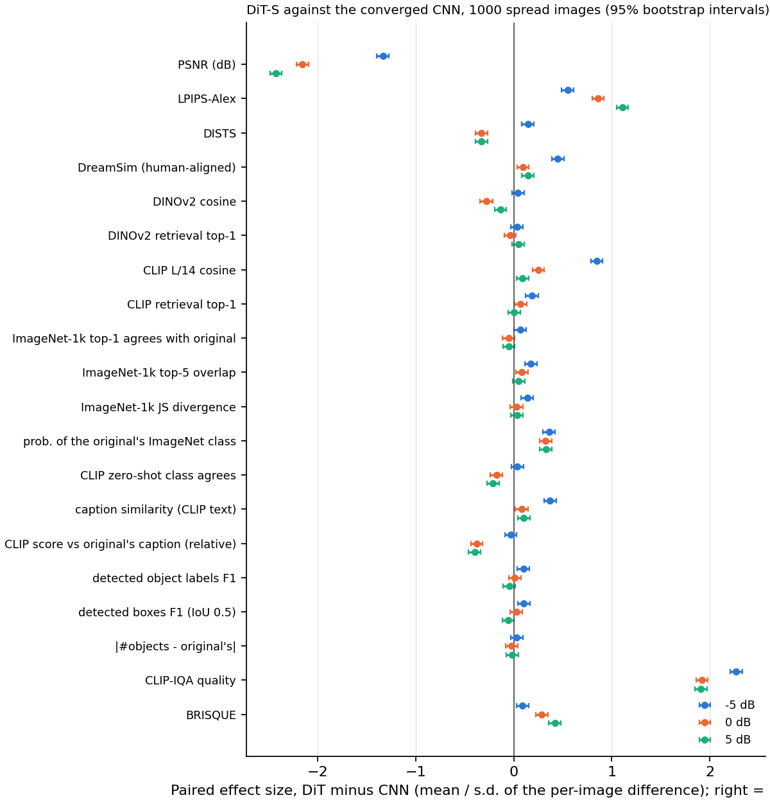

# What the DiT does better than the converged CNN (exploratory)

Protocol fixed before computing (month plan, 22 Nov). Positive differences favour the DiT. A metric
counts as a DiT advantage only if its paired 95% interval favours the DiT on both the exploration
(even) and confirmation (odd) halves at 0 and +5 dB.

| metric | group | -5 dB: DiT / CNN, diff [95%], win rate | 0 dB: DiT / CNN, diff [95%], win rate | 5 dB: DiT / CNN, diff [95%], win rate | verdict |
|---|---|---|---|---|---|
| PSNR (dB) | pixel | 17.047 / 18.462, -1.416 [-1.481, -1.350], 7% | 19.721 / 21.288, -1.566 [-1.611, -1.520], 2% | 21.020 / 22.787, -1.766 [-1.810, -1.721], 1% | CNN advantage (confirmed) |
| LPIPS-Alex | perceptual | 0.371 / 0.402, +0.031 [+0.028, +0.035], 73% | 0.249 / 0.288, +0.039 [+0.037, +0.042], 85% | 0.196 / 0.246, +0.050 [+0.047, +0.053], 89% | DiT advantage (confirmed) |
| DISTS | perceptual | 0.262 / 0.266, +0.004 [+0.002, +0.006], 56% | 0.208 / 0.200, -0.007 [-0.009, -0.006], 38% | 0.179 / 0.172, -0.007 [-0.008, -0.006], 36% | CNN advantage (confirmed) |
| DreamSim (human-aligned) | perceptual | 0.391 / 0.432, +0.041 [+0.035, +0.047], 68% | 0.229 / 0.234, +0.005 [+0.002, +0.008], 54% | 0.166 / 0.172, +0.006 [+0.003, +0.008], 58% | DiT advantage (confirmed) |
| DINOv2 cosine | semantic | 0.304 / 0.297, +0.008 [-0.003, +0.019], 52% | 0.561 / 0.604, -0.043 [-0.053, -0.033], 41% | 0.703 / 0.720, -0.017 [-0.024, -0.009], 47% | CNN advantage (confirmed) |
| DINOv2 retrieval top-1 | semantic | 0.272 / 0.254, +0.018 [-0.015, +0.053], 16% | 0.809 / 0.826, -0.017 [-0.045, +0.011], 10% | 0.954 / 0.941, +0.013 [-0.005, +0.030], 4% | mixed / tie |
| CLIP L/14 cosine | semantic | 0.681 / 0.623, +0.058 [+0.054, +0.063], 82% | 0.747 / 0.729, +0.018 [+0.014, +0.023], 60% | 0.791 / 0.785, +0.006 [+0.002, +0.010], 54% | mixed / tie |
| CLIP retrieval top-1 | semantic | 0.047 / 0.011, +0.036 [+0.024, +0.049], 4% | 0.187 / 0.158, +0.029 [+0.003, +0.056], 10% | 0.369 / 0.367, +0.002 [-0.031, +0.035], 14% | mixed / tie |
| ImageNet-1k top-1 agrees with original | semantic | 0.499 / 0.464, +0.035 [+0.002, +0.067], 15% | 0.771 / 0.794, -0.023 [-0.051, +0.004], 9% | 0.861 / 0.880, -0.019 [-0.040, +0.003], 6% | mixed / tie |
| ImageNet-1k top-5 overlap | semantic | 0.359 / 0.311, +0.048 [+0.031, +0.065], 39% | 0.566 / 0.546, +0.020 [+0.005, +0.036], 35% | 0.654 / 0.642, +0.012 [-0.002, +0.026], 31% | mixed / tie |
| ImageNet-1k JS divergence | semantic | 0.258 / 0.284, +0.026 [+0.014, +0.037], 56% | 0.110 / 0.113, +0.004 [-0.005, +0.013], 64% | 0.059 / 0.062, +0.003 [-0.003, +0.009], 69% | mixed / tie |
| prob. of the original's ImageNet class | semantic | 0.336 / 0.235, +0.101 [+0.084, +0.118], 60% | 0.552 / 0.474, +0.078 [+0.063, +0.093], 69% | 0.632 / 0.570, +0.063 [+0.051, +0.075], 72% | DiT advantage (confirmed) |
| CLIP zero-shot class agrees | semantic | 0.187 / 0.171, +0.016 [-0.012, +0.045], 11% | 0.394 / 0.485, -0.091 [-0.124, -0.060], 9% | 0.523 / 0.628, -0.105 [-0.133, -0.074], 7% | CNN advantage (confirmed) |
| caption similarity (CLIP text) | language | 0.707 / 0.657, +0.050 [+0.042, +0.059], 64% | 0.793 / 0.782, +0.011 [+0.002, +0.019], 50% | 0.837 / 0.826, +0.012 [+0.005, +0.019], 47% | mixed / tie |
| CLIP score vs original's caption (relative) | language | 0.847 / 0.851, -0.004 [-0.012, +0.004], 49% | 0.943 / 0.988, -0.045 [-0.053, -0.038], 36% | 0.987 / 1.030, -0.043 [-0.050, -0.036], 34% | CNN advantage (confirmed) |
| detected object labels F1 | objects | 0.322 / 0.278, +0.043 [+0.016, +0.071], 28% | 0.405 / 0.400, +0.005 [-0.023, +0.032], 24% | 0.444 / 0.465, -0.021 [-0.049, +0.008], 26% | mixed / tie |
| detected boxes F1 (IoU 0.5) | objects | 0.275 / 0.232, +0.043 [+0.016, +0.069], 25% | 0.370 / 0.359, +0.012 [-0.015, +0.038], 24% | 0.408 / 0.433, -0.025 [-0.051, +0.001], 24% | mixed / tie |
| |#objects - original's| | objects | 1.888 / 1.927, +0.039 [-0.039, +0.120], 33% | 1.641 / 1.611, -0.030 [-0.117, +0.059], 28% | 1.498 / 1.476, -0.022 [-0.100, +0.065], 28% | mixed / tie |
| CLIP-IQA quality | no-reference | 0.809 / 0.321, +0.487 [+0.474, +0.500], 98% | 0.828 / 0.433, +0.395 [+0.382, +0.407], 98% | 0.837 / 0.463, +0.373 [+0.361, +0.385], 98% | DiT advantage (confirmed) |
| BRISQUE | no-reference | 22.565 / 23.752, +1.187 [+0.386, +2.126], 54% | 21.642 / 25.404, +3.762 [+2.951, +4.555], 64% | 21.319 / 26.436, +5.118 [+4.328, +5.842], 69% | DiT advantage (confirmed) |

## Distribution (precision = realism, recall / coverage = diversity of the outputs)

| SNR | system | DINOv2 P / R / D / C | CLIP P / R / D / C |
|---|---|---|---|
| -5 | dit | 0.352 / 0.433 / 0.111 / 0.139 | 0.673 / 0.048 / 0.310 / 0.101 |
| -5 | cnn | 0.359 / 0.268 / 0.106 / 0.125 | 0.236 / 0.003 / 0.141 / 0.037 |
| 0 | dit | 0.645 / 0.813 / 0.288 / 0.538 | 0.605 / 0.214 / 0.329 / 0.286 |
| 0 | cnn | 0.686 / 0.745 / 0.315 / 0.558 | 0.410 / 0.106 / 0.228 / 0.208 |
| 5 | dit | 0.814 / 0.977 / 0.469 / 0.801 | 0.647 / 0.378 / 0.361 / 0.471 |
| 5 | cnn | 0.846 / 0.937 / 0.477 / 0.798 | 0.549 / 0.198 / 0.296 / 0.387 |

## Content: on which originals does the DiT gain? (Spearman of the per-image gain with the property;
mean gain in the lowest and highest quartile of the property)

**-5 dB**

| metric | edge density | high-frequency energy | colourfulness | best classes for the DiT | worst |
|---|---|---|---|---|---|
| dreamsim | r = -0.12, +0.055 -> +0.021 | r = -0.11, +0.051 -> +0.023 | r = +0.04, +0.034 -> +0.046 | tench, golf ball, parachute | French horn, church, chain saw |
| dino_sim | r = -0.12, +0.048 -> -0.023 | r = -0.10, +0.043 -> -0.012 | r = +0.03, -0.013 -> +0.023 | parachute, tench, golf ball | chain saw, church, cassette player |
| clip_sim | r = -0.14, +0.071 -> +0.042 | r = -0.12, +0.071 -> +0.044 | r = +0.14, +0.044 -> +0.074 | parachute, golf ball, church | English springer, cassette player, chain saw |
| lpips | r = -0.03, +0.033 -> +0.031 | r = -0.03, +0.033 -> +0.031 | r = +0.10, +0.027 -> +0.042 | parachute, golf ball, gas pump | French horn, tench, chain saw |
| caption_sim | r = -0.07, +0.066 -> +0.042 | r = -0.06, +0.061 -> +0.036 | r = -0.02, +0.045 -> +0.042 | tench, English springer, golf ball | cassette player, church, gas pump |
| psnr | r = -0.19, -1.078 -> -1.622 | r = -0.19, -1.072 -> -1.646 | r = +0.10, -1.488 -> -1.159 | golf ball, parachute, cassette player | chain saw, English springer, French horn |

**0 dB**

| metric | edge density | high-frequency energy | colourfulness | best classes for the DiT | worst |
|---|---|---|---|---|---|
| dreamsim | r = -0.03, +0.013 -> +0.003 | r = -0.06, +0.012 -> +0.004 | r = +0.02, +0.002 -> +0.006 | English springer, parachute, tench | chain saw, gas pump, cassette player |
| dino_sim | r = -0.14, -0.005 -> -0.059 | r = -0.14, -0.010 -> -0.061 | r = +0.01, -0.044 -> -0.048 | parachute, tench, English springer | chain saw, cassette player, French horn |
| clip_sim | r = -0.09, +0.029 -> +0.011 | r = -0.09, +0.031 -> +0.014 | r = +0.18, +0.002 -> +0.040 | parachute, church, golf ball | chain saw, gas pump, cassette player |
| lpips | r = +0.26, +0.023 -> +0.056 | r = +0.21, +0.025 -> +0.050 | r = +0.08, +0.034 -> +0.043 | church, English springer, gas pump | tench, chain saw, cassette player |
| caption_sim | r = -0.05, +0.024 -> +0.003 | r = -0.06, +0.023 -> +0.004 | r = +0.05, +0.001 -> +0.023 | parachute, tench, church | cassette player, gas pump, chain saw |
| psnr | r = -0.19, -1.282 -> -1.684 | r = -0.21, -1.294 -> -1.772 | r = +0.18, -1.704 -> -1.402 | golf ball, parachute, tench | chain saw, garbage truck, French horn |

**5 dB**

| metric | edge density | high-frequency energy | colourfulness | best classes for the DiT | worst |
|---|---|---|---|---|---|
| dreamsim | r = +0.05, +0.007 -> +0.010 | r = +0.01, +0.005 -> +0.005 | r = +0.05, +0.003 -> +0.009 | English springer, tench, parachute | golf ball, gas pump, cassette player |
| dino_sim | r = -0.11, +0.001 -> -0.032 | r = -0.10, -0.002 -> -0.030 | r = +0.04, -0.020 -> -0.009 | parachute, tench, English springer | chain saw, French horn, gas pump |
| clip_sim | r = -0.08, +0.017 -> +0.002 | r = -0.08, +0.016 -> +0.000 | r = +0.15, -0.005 -> +0.026 | church, parachute, English springer | cassette player, garbage truck, gas pump |
| lpips | r = +0.43, +0.026 -> +0.075 | r = +0.32, +0.027 -> +0.064 | r = +0.05, +0.044 -> +0.050 | church, English springer, gas pump | chain saw, golf ball, cassette player |
| caption_sim | r = +0.03, +0.014 -> +0.016 | r = +0.01, +0.015 -> +0.011 | r = +0.01, +0.014 -> +0.017 | tench, church, French horn | parachute, gas pump, garbage truck |
| psnr | r = -0.20, -1.525 -> -1.892 | r = -0.22, -1.553 -> -1.958 | r = +0.19, -1.883 -> -1.608 | golf ball, parachute, tench | chain saw, garbage truck, French horn |

## Captions where the two systems disagree most (0 dB)

**dit_better**

- [gas pump] original: *there is a yellow gas pump sitting in front of a gas station* | DiT: *there is a yellow gas pump sitting in front of a building* (0.94) | CNN: *painting of a clock tower with a flag flying in the background* (0.36)
- [church] original: *black and white photo of a church altar with a cross and candles* | DiT: *this is a black and white photo of a church altar with a cross* (0.88) | CNN: *there is a bench in the middle of a room with a sign on it* (0.33)
- [church] original: *there is a large building with a clock on the front of it* | DiT: *there is a painting of a building with a clock tower on top of it* (0.83) | CNN: *painting of a church at night with a horse and carriage in the foreground* (0.35)
- [golf ball] original: *there is a red golf ball on a green surface with a tree in the background* | DiT: *there is a red ball sitting on a green surface with a tree in the background* (0.92) | CNN: *there is a blurry image of a person throwing a ball* (0.51)
- [parachute] original: *there is a man that is standing in the grass with a parachute* | DiT: *there is a man that is standing in the grass with a kite* (0.90) | CNN: *there is a blurry photo of a baseball player holding a bat* (0.49)
- [French horn] original: *there is a man that is holding a french horn in his hand* | DiT: *there is a man that is holding a french horn in his hand* (1.00) | CNN: *painting of a man in a red shirt holding a french horn* (0.60)
- [tench] original: *there is a man kneeling in the grass holding a fish* | DiT: *there is a woman kneeling in the grass holding a large fish* (0.92) | CNN: *there is a blurry photo of a woman sitting on a bench* (0.53)
- [tench] original: *there is a fish that is standing in the water with it ' s mouth open* | DiT: *there is a fish that is standing in the water by the shore* (0.91) | CNN: *there is a blurry photo of a yellow fire hydrant in the grass* (0.52)

**cnn_better**

- [gas pump] original: *there are two gas pumps sitting on the side of the road* | DiT: *there are two red and white coolers sitting on the back of a boat* (0.53) | CNN: *there are two gas pumps sitting on the side of the road* (1.00)
- [garbage truck] original: *there is a red truck that is driving down the street* | DiT: *painting of an orange dump truck on a city street with buildings in the background* (0.45) | CNN: *there is a red dump truck that is driving down the street* (0.92)
- [chain saw] original: *there is a man that is cutting a tree with a chainsaw* | DiT: *there is a woman that is standing in the dirt with an umbrella* (0.60) | CNN: *there is a man that is cutting a tree with a chainsaw* (1.00)
- [cassette player] original: *there is a radio that is sitting on top of a table* | DiT: *this is an image of a cd player on a white surface* (0.60) | CNN: *there is a radio that is on top of a table* (0.99)
- [cassette player] original: *there is a radio that is sitting on a table* | DiT: *there is a black and white picture of a remote control in a box* (0.60) | CNN: *there is a radio that is sitting on top of a table* (0.98)
- [French horn] original: *there is a close up of a brass instrument on a black background* | DiT: *there is a person holding a french horn in their hand* (0.61) | CNN: *there is a close up of a brass instrument with a black background* (0.98)
- [French horn] original: *there are a lot of people that are marching in the street* | DiT: *painting of a marching band in a parade with a bus in the background* (0.43) | CNN: *there is a man that is playing a musical instrument on the street* (0.80)
- [cassette player] original: *an image of a radio with ear buds on a white background* | DiT: *this is an image of a blue and black case with a cat on it* (0.41) | CNN: *there is a radio with headphones attached to it on a white surface* (0.78)

**random**

- [English springer] original: *there are two dogs playing with each other in a cardboard box* | DiT: *there are two dogs that are laying in a box together* (0.89) | CNN: *there are two dogs that are laying down together on the floor* (0.75)
- [English springer] original: *there are five puppies laying on a brick wall in the grass* | DiT: *there are a lot of dogs that are laying on a brick wall* (0.83) | CNN: *there are four puppies laying on top of a brick wall* (0.92)
- [English springer] original: *there is a brown and white dog playing with a ball in the grass* | DiT: *there is a brown and white dog eating grass in the yard* (0.88) | CNN: *there are two dogs playing with a frisbee in the grass* (0.85)
- [garbage truck] original: *there is a garbage truck that is parked on the side of the road* | DiT: *there is a large tanker truck that is parked in the grass* (0.81) | CNN: *there is a truck that is parked on the side of the road* (0.92)
- [church] original: *there is a picture of a cemetery with a church in the background* | DiT: *there is a picture of a cemetery with a stone building in the background* (0.90) | CNN: *there is a painting of a building with a clock on the top of it* (0.62)
- [church] original: *there is a very tall building with a clock on the top of it* | DiT: *there is a very tall building with a very steeple on the side of it* (0.90) | CNN: *this is an image of a large cathedral with a clock on it* (0.80)
