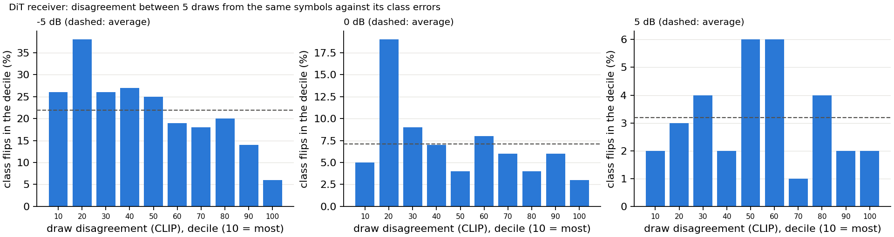

# Can the diffusion receiver flag its own errors? (exploratory, 23 Nov)

5 draws per image from the same received symbols (the evaluation's draw first). Uncertainty =
1 - mean pairwise cosine of the draws' embeddings; it needs no original. AUROC 0.5 = no signal.

## -5 dB

Error rates of the evaluation draw: class flip (DINOv2 k-NN vs label) 21.9%, retrieval miss (DINOv2) 72.8%

- AUROC CLIP draws -> class flip (DINOv2 k-NN vs label): **0.383** [0.343, 0.425]
- AUROC CLIP draws -> retrieval miss (DINOv2): **0.402** [0.366, 0.443]
- Spearman CLIP draws vs DINOv2 similarity: r = +0.287
- AUROC DINOv2 draws -> class flip (DINOv2 k-NN vs label): **0.711** [0.676, 0.747]
- AUROC DINOv2 draws -> retrieval miss (DINOv2): **0.652** [0.612, 0.688]
- Spearman DINOv2 draws vs DINOv2 similarity: r = -0.524
- AUROC (1 - draw class agreement) -> class flip: 0.873
- Error after flagging the most uncertain (CLIP draws): 0%: 21.9%, 72.8%; 10%: 23.7%, 75.2%; 20%: 24.9%, 75.6%; 30%: 25.6%, 76.0%
- Medoid draw vs evaluation draw: DINOv2 similarity 0.304 -> 0.300; DINOv2 retrieval top-1 0.272 -> 0.276; class kept 0.781 -> 0.773

## 0 dB

Error rates of the evaluation draw: class flip (DINOv2 k-NN vs label) 7.1%, retrieval miss (DINOv2) 19.1%

- AUROC CLIP draws -> class flip (DINOv2 k-NN vs label): **0.404** [0.340, 0.475]
- AUROC CLIP draws -> retrieval miss (DINOv2): **0.487** [0.442, 0.532]
- Spearman CLIP draws vs DINOv2 similarity: r = +0.047
- AUROC DINOv2 draws -> class flip (DINOv2 k-NN vs label): **0.789** [0.748, 0.827]
- AUROC DINOv2 draws -> retrieval miss (DINOv2): **0.662** [0.621, 0.704]
- Spearman DINOv2 draws vs DINOv2 similarity: r = -0.768
- AUROC (1 - draw class agreement) -> class flip: 0.883
- Error after flagging the most uncertain (CLIP draws): 0%: 7.1%, 19.1%; 10%: 7.6%, 19.6%; 20%: 7.8%, 18.5%; 30%: 8.3%, 18.7%
- Medoid draw vs evaluation draw: DINOv2 similarity 0.561 -> 0.561; DINOv2 retrieval top-1 0.809 -> 0.793; class kept 0.929 -> 0.932

## 5 dB

Error rates of the evaluation draw: class flip (DINOv2 k-NN vs label) 3.2%, retrieval miss (DINOv2) 4.6%

- AUROC CLIP draws -> class flip (DINOv2 k-NN vs label): **0.482** [0.387, 0.572]
- AUROC CLIP draws -> retrieval miss (DINOv2): **0.459** [0.375, 0.536]
- Spearman CLIP draws vs DINOv2 similarity: r = -0.147
- AUROC DINOv2 draws -> class flip (DINOv2 k-NN vs label): **0.831** [0.778, 0.883]
- AUROC DINOv2 draws -> retrieval miss (DINOv2): **0.649** [0.552, 0.738]
- Spearman DINOv2 draws vs DINOv2 similarity: r = -0.822
- AUROC (1 - draw class agreement) -> class flip: 0.821
- Error after flagging the most uncertain (CLIP draws): 0%: 3.2%, 4.6%; 10%: 3.3%, 4.8%; 20%: 3.5%, 5.0%; 30%: 3.4%, 5.1%
- Medoid draw vs evaluation draw: DINOv2 similarity 0.703 -> 0.700; DINOv2 retrieval top-1 0.954 -> 0.943; class kept 0.968 -> 0.970

## LPIPS-VGG (the CNN's own fine-tuning loss)

- lpips_vgg_cnn_-5: 0.4429
- lpips_vgg_cnn_0: 0.3305
- lpips_vgg_cnn_5: 0.2793
- lpips_vgg_dit_-5: 0.4563
- lpips_vgg_dit_0: 0.3547
- lpips_vgg_dit_5: 0.3026