# Analysis: 256 px test, 16-QAM, CBR 1/48: blind DiT-S to convergence against the blind two-stage CNN (same images, same GPU)

Reference: **CNN, MSE+LPIPS, blind, 256 px** (`results\gen\p256-perc\cnn_cbr48_qam16_blind-5to5_lpips0.1_ft_s0`). Test set: the 1,000 class-spread test images, 10 sampling steps, paired channel and sampling noise; all runs scored on the same GPU type.

| Key | System | Run |
|---|---|---|
| cnn | CNN, MSE+LPIPS, blind, 256 px | `results\gen\p256-perc\cnn_cbr48_qam16_blind-5to5_lpips0.1_ft_s0` |
| dit | DiT-S, blind, 256 px | `results\gen\p256-conv\dit-S-v_cbr48_qam16_blind-5to5_s0` |
| cnnpx | CNN, MSE only (stage 1), 256 px | `results\gen\p256-perc\cnn_cbr48_qam16_blind-5to5_s0` |

## 1. Verdict against the pre-registered rule

Rule fixed on 17 Nov before any result: a candidate **beats the reference** if, at 0 and +5 dB, it has a clear gain on LPIPS (95% interval below 0) or on FID (more than 5 points lower), and no clear loss (interval entirely on the wrong side) on DINOv2 similarity or retrieval top-1. Between candidates that pass, the higher DINOv2 similarity wins.

| Candidate | 0 dB: perceptual gain / semantic loss | 5 dB: perceptual gain / semantic loss | Verdict |
|---|---|---|---|
| DiT-S, blind, 256 px | yes / no | yes / no | **passes** |
| CNN, MSE only (stage 1), 256 px | no / yes | no / yes | does not pass |

Chosen by the rule: **DiT-S, blind, 256 px**.

## 2. Metrics against SNR

Means over the 1,000 images. FID uses 1,000 images (relative only). Class kept: DINOv2 10-NN classifier on the reconstructions (from the dump).

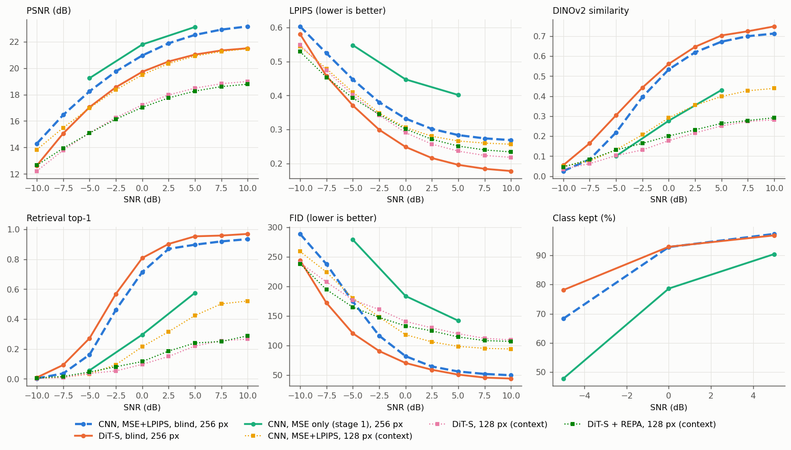

Dotted lines are context only (CNN, MSE+LPIPS, 128 px, DiT-S, 128 px, DiT-S + REPA, 128 px): scored on their own images, so they are not paired with or judged against the systems above.

| SNR | System | PSNR | LPIPS | DINOv2 | Top-1 | FID | Class kept |
|---|---|---|---|---|---|---|---|
| -10 | CNN, MSE+LPIPS, blind, 256 px | 14.29 | 0.603 | 0.026 | 0% | 289 |  |
| -10 | DiT-S, blind, 256 px | 12.64 | 0.580 | 0.055 | 1% | 244 |  |
| -10 | CNN, MSE+LPIPS, 128 px (context) | 13.83 | 0.544 | 0.049 | 0% | 259 |  |
| -10 | DiT-S, 128 px (context) | 12.22 | 0.549 | 0.036 | 0% | 240 |  |
| -10 | DiT-S + REPA, 128 px (context) | 12.65 | 0.529 | 0.046 | 1% | 238 |  |
| -7.5 | CNN, MSE+LPIPS, blind, 256 px | 16.46 | 0.524 | 0.084 | 4% | 238 |  |
| -7.5 | DiT-S, blind, 256 px | 15.06 | 0.457 | 0.165 | 9% | 172 |  |
| -7.5 | CNN, MSE+LPIPS, 128 px (context) | 15.49 | 0.479 | 0.076 | 1% | 224 |  |
| -7.5 | DiT-S, 128 px (context) | 13.79 | 0.473 | 0.063 | 1% | 207 |  |
| -7.5 | DiT-S + REPA, 128 px (context) | 13.94 | 0.454 | 0.084 | 2% | 194 |  |
| -5 | CNN, MSE+LPIPS, blind, 256 px | 18.25 | 0.447 | 0.218 | 16% | 174 | 68% |
| -5 | DiT-S, blind, 256 px | 17.05 | 0.371 | 0.304 | 27% | 120 | 78% |
| -5 | CNN, MSE only (stage 1), 256 px | 19.24 | 0.548 | 0.101 | 6% | 279 | 48% |
| -5 | CNN, MSE+LPIPS, 128 px (context) | 16.98 | 0.410 | 0.132 | 3% | 180 |  |
| -5 | DiT-S, 128 px (context) | 15.11 | 0.402 | 0.103 | 4% | 177 |  |
| -5 | DiT-S + REPA, 128 px (context) | 15.09 | 0.393 | 0.131 | 5% | 165 |  |
| -2.5 | CNN, MSE+LPIPS, blind, 256 px | 19.75 | 0.380 | 0.395 | 46% | 116 |  |
| -2.5 | DiT-S, blind, 256 px | 18.55 | 0.300 | 0.443 | 57% | 90 |  |
| -2.5 | CNN, MSE+LPIPS, 128 px (context) | 18.36 | 0.349 | 0.207 | 9% | 148 |  |
| -2.5 | DiT-S, 128 px (context) | 16.26 | 0.342 | 0.131 | 5% | 161 |  |
| -2.5 | DiT-S + REPA, 128 px (context) | 16.14 | 0.345 | 0.164 | 8% | 147 |  |
| 0 | CNN, MSE+LPIPS, blind, 256 px | 20.95 | 0.332 | 0.533 | 71% | 82 | 93% |
| 0 | DiT-S, blind, 256 px | 19.72 | 0.249 | 0.561 | 81% | 70 | 93% |
| 0 | CNN, MSE only (stage 1), 256 px | 21.78 | 0.447 | 0.277 | 30% | 184 | 79% |
| 0 | CNN, MSE+LPIPS, 128 px (context) | 19.49 | 0.306 | 0.292 | 22% | 118 |  |
| 0 | DiT-S, 128 px (context) | 17.22 | 0.291 | 0.178 | 10% | 141 |  |
| 0 | DiT-S + REPA, 128 px (context) | 17.03 | 0.301 | 0.201 | 12% | 133 |  |
| 2.5 | CNN, MSE+LPIPS, blind, 256 px | 21.88 | 0.302 | 0.619 | 87% | 64 |  |
| 2.5 | DiT-S, blind, 256 px | 20.50 | 0.216 | 0.647 | 90% | 59 |  |
| 2.5 | CNN, MSE+LPIPS, 128 px (context) | 20.35 | 0.280 | 0.355 | 32% | 106 |  |
| 2.5 | DiT-S, 128 px (context) | 17.97 | 0.257 | 0.216 | 15% | 130 |  |
| 2.5 | DiT-S + REPA, 128 px (context) | 17.75 | 0.271 | 0.232 | 19% | 125 |  |
| 5 | CNN, MSE+LPIPS, blind, 256 px | 22.51 | 0.284 | 0.672 | 90% | 56 | 97% |
| 5 | DiT-S, blind, 256 px | 21.02 | 0.196 | 0.703 | 95% | 51 | 97% |
| 5 | CNN, MSE only (stage 1), 256 px | 23.11 | 0.402 | 0.431 | 58% | 142 | 90% |
| 5 | CNN, MSE+LPIPS, 128 px (context) | 20.91 | 0.266 | 0.398 | 42% | 98 |  |
| 5 | DiT-S, 128 px (context) | 18.48 | 0.237 | 0.251 | 22% | 120 |  |
| 5 | DiT-S + REPA, 128 px (context) | 18.26 | 0.251 | 0.264 | 24% | 114 |  |
| 7.5 | CNN, MSE+LPIPS, blind, 256 px | 22.91 | 0.274 | 0.699 | 92% | 52 |  |
| 7.5 | DiT-S, blind, 256 px | 21.33 | 0.185 | 0.724 | 96% | 45 |  |
| 7.5 | CNN, MSE+LPIPS, 128 px (context) | 21.25 | 0.260 | 0.427 | 50% | 95 |  |
| 7.5 | DiT-S, 128 px (context) | 18.82 | 0.224 | 0.273 | 25% | 112 |  |
| 7.5 | DiT-S + REPA, 128 px (context) | 18.60 | 0.240 | 0.278 | 25% | 108 |  |
| 10 | CNN, MSE+LPIPS, blind, 256 px | 23.15 | 0.269 | 0.713 | 94% | 49 |  |
| 10 | DiT-S, blind, 256 px | 21.50 | 0.178 | 0.748 | 97% | 44 |  |
| 10 | CNN, MSE+LPIPS, 128 px (context) | 21.47 | 0.257 | 0.439 | 52% | 94 |  |
| 10 | DiT-S, 128 px (context) | 18.99 | 0.218 | 0.282 | 27% | 109 |  |
| 10 | DiT-S + REPA, 128 px (context) | 18.78 | 0.234 | 0.292 | 29% | 107 |  |

## 3. Paired differences against the reference

Candidate minus reference per image, mean with 95% bootstrap interval; **bold** = clear gain, *italic* = clear loss. Win rate: share of images where the candidate is better.

| Candidate | SNR | ΔPSNR (dB) | ΔLPIPS | ΔDINOv2 | ΔTop-1 (pts) | ΔTop-5 (pts) | Win rate PSNR / LPIPS / DINOv2 |
|---|---|---|---|---|---|---|---|
| DiT-S, blind, 256 px | -5 | *-1.20 [-1.27, -1.13]* | **-0.076 [-0.081, -0.072]** | **+0.086 [+0.075, +0.098]** | **+11.0 [+7.8, +14.4]** | **+16.4 [+12.6, +20.4]** | 11% / 90% / 66% |
| DiT-S, blind, 256 px | 0 | *-1.23 [-1.28, -1.18]* | **-0.083 [-0.087, -0.080]** | **+0.028 [+0.017, +0.038]** | **+9.4 [+6.2, +12.8]** | **+2.5 [+0.3, +4.5]** | 6% / 93% / 58% |
| DiT-S, blind, 256 px | 5 | *-1.49 [-1.54, -1.44]* | **-0.087 [-0.091, -0.084]** | **+0.031 [+0.023, +0.039]** | **+5.6 [+3.6, +7.6]** | **+0.9 [+0.1, +1.8]** | 3% / 94% / 63% |
| CNN, MSE only (stage 1), 256 px | -5 | **+0.99 [+0.97, +1.02]** | *+0.101 [+0.098, +0.103]* | *-0.118 [-0.126, -0.110]* | *-10.5 [-12.6, -8.5]* | *-21.5 [-24.2, -18.5]* | 99% / 1% / 15% |
| CNN, MSE only (stage 1), 256 px | 0 | **+0.83 [+0.81, +0.85]** | *+0.115 [+0.113, +0.118]* | *-0.256 [-0.266, -0.246]* | *-41.9 [-45.1, -38.5]* | *-35.3 [-38.4, -32.1]* | 100% / 0% / 4% |
| CNN, MSE only (stage 1), 256 px | 5 | **+0.60 [+0.58, +0.62]** | *+0.118 [+0.115, +0.121]* | *-0.241 [-0.251, -0.232]* | *-32.2 [-35.2, -29.1]* | *-14.3 [-16.6, -12.1]* | 99% / 0% / 3% |

## 4. Perception-distortion and perception-semantics planes

Each line is one system across SNR (marker size grows with SNR). Down-right is better in both panels: a system that only trades along a line moved along the trade-off, one that moves the whole line beat it.

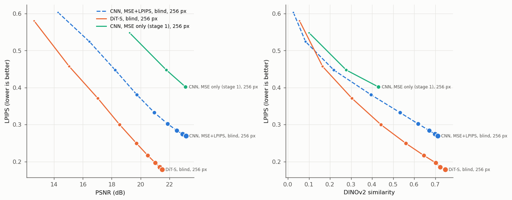

## 5. Per image: does a perceptual gain cost semantics on the same image?

Each dot is one test image: x = ΔLPIPS (left of 0 = sharper / closer perceptually), y = ΔDINOv2 (above 0 = semantically closer), candidate minus reference. The corner shares say how often a candidate wins on both, only perceptually, only semantically, or on neither.

**0 dB**

| Candidate | Both better | Perceptual only | Semantic only | Neither |
|---|---|---|---|---|
| DiT-S, blind, 256 px | 55% | 39% | 3% | 4% |
| CNN, MSE only (stage 1), 256 px | 0% | 0% | 4% | 96% |

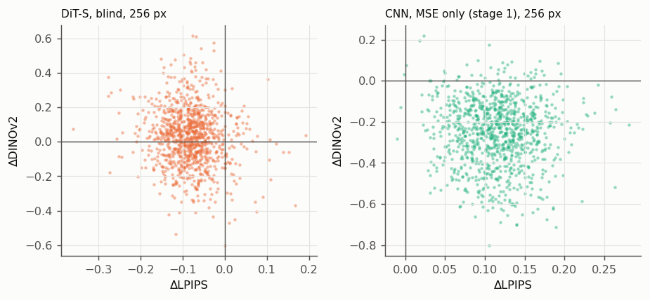

**5 dB**

| Candidate | Both better | Perceptual only | Semantic only | Neither |
|---|---|---|---|---|
| DiT-S, blind, 256 px | 61% | 34% | 3% | 3% |
| CNN, MSE only (stage 1), 256 px | 0% | 0% | 3% | 97% |

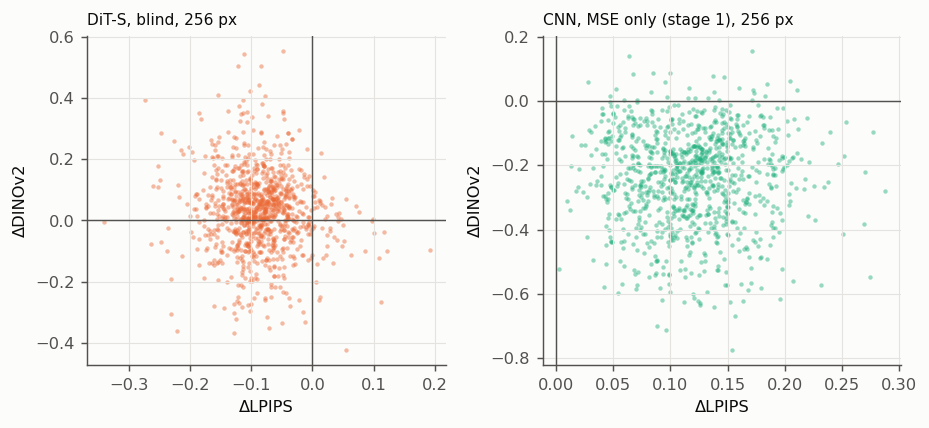

## 6. Class kept per class

DINOv2 10-NN class of each reconstruction against the true class, 1000 images (100 per class on average).

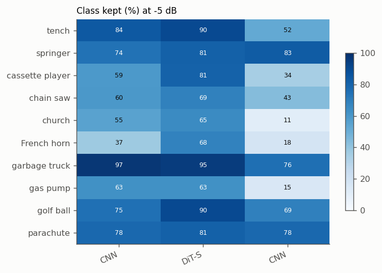

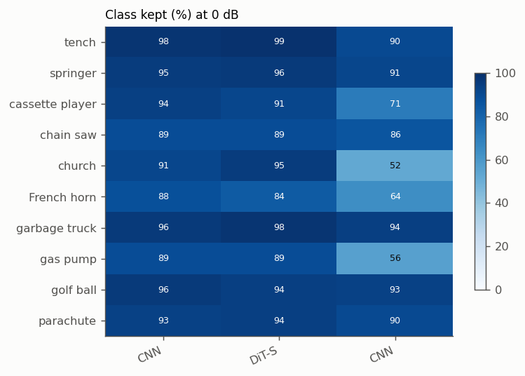

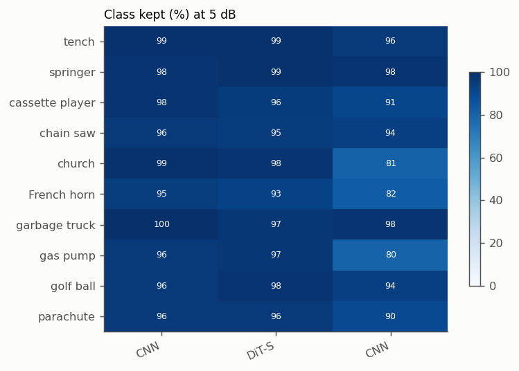

## 7. Images

One test image per class. Under each reconstruction: the class the classifier sees (✓ = true class) and the image's PSNR.

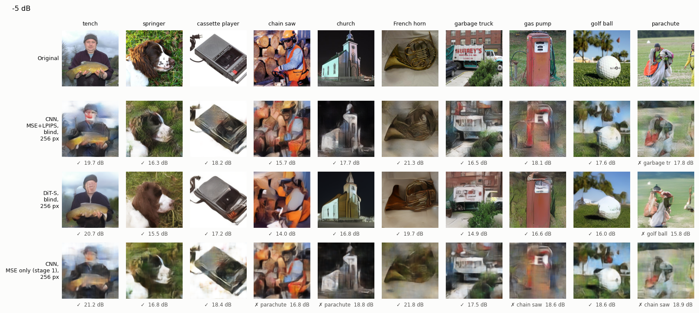

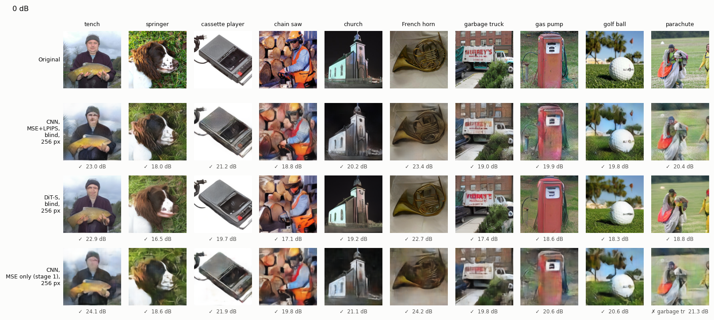

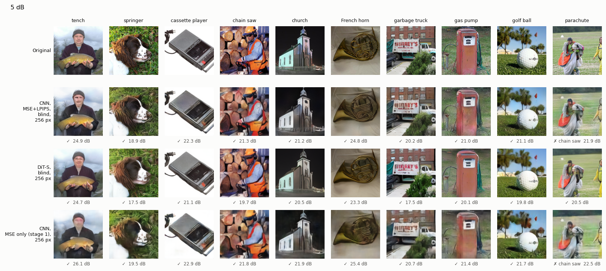

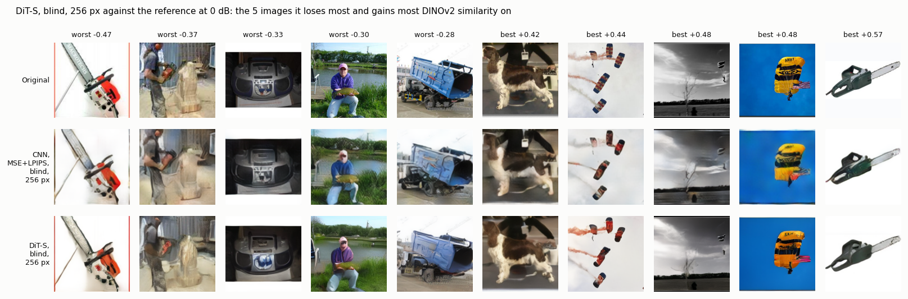

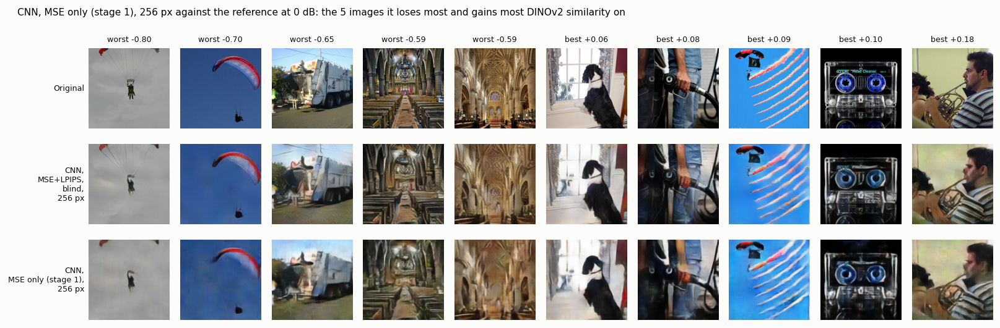

### Close-ups at full resolution

4 images at their native 256 px (one image pixel per figure pixel), each followed by its centre third enlarged: blur, invented texture and artefacts show here. Under each reconstruction: its PSNR | DINOv2 similarity to the original.

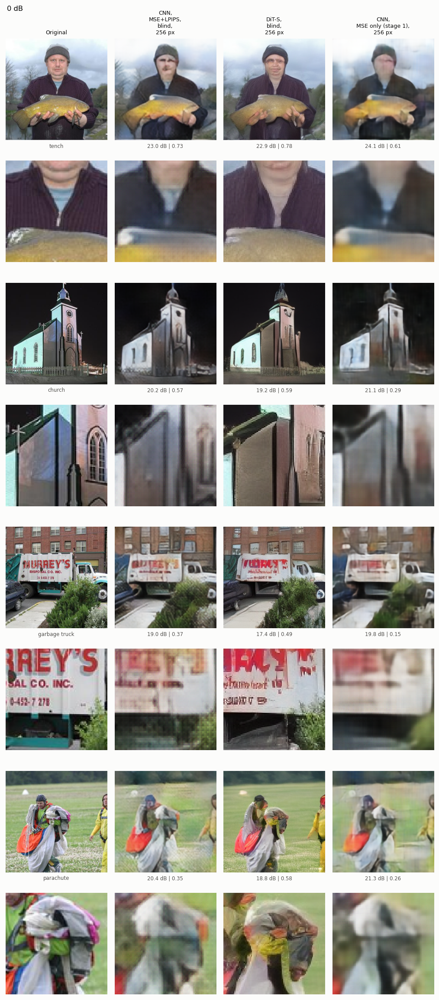

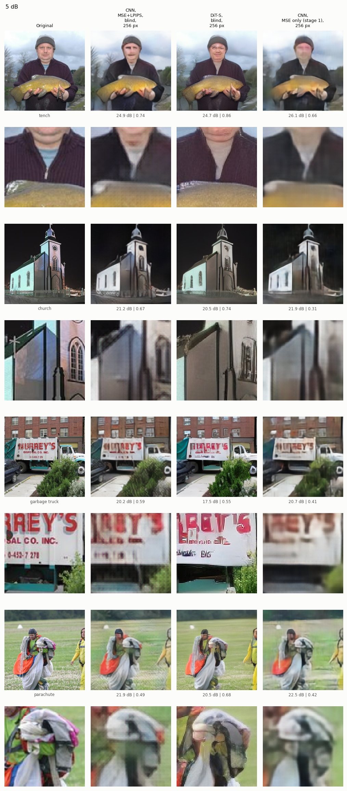

## 8. Power spectrum against the originals

Radially averaged power spectrum of the reconstructions over that of the originals (kept images, grey level). Below 1 at high frequency = blur (detail removed); above 1 = texture or noise added that the original does not have.

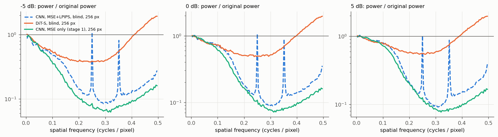

High-frequency power (upper half of the band) relative to the originals:

| System | -5 dB | 0 dB | 5 dB |
|---|---|---|---|
| CNN, MSE+LPIPS, blind, 256 px | 0.16 | 0.18 | 0.18 |
| DiT-S, blind, 256 px | 0.87 | 0.98 | 1.04 |
| CNN, MSE only (stage 1), 256 px | 0.09 | 0.10 | 0.11 |

## 9. Image statistics against the originals

Ratios to the original image (1 = same): sharpness = variance of the Laplacian, contrast = pixel standard deviation, saturation = mean HSV saturation; colour shift = mean absolute change of the per-channel means (0-255). Means over the kept images.

| System | SNR | Sharpness | Contrast | Saturation | Colour shift |
|---|---|---|---|---|---|
| CNN, MSE+LPIPS, blind, 256 px | -5 | 0.14 | 0.88 | 0.80 | 3.6 |
| DiT-S, blind, 256 px | -5 | 0.90 | 0.94 | 0.92 | 5.1 |
| CNN, MSE only (stage 1), 256 px | -5 | 0.04 | 0.89 | 0.83 | 2.6 |
| CNN, MSE+LPIPS, blind, 256 px | 0 | 0.16 | 0.93 | 0.87 | 2.2 |
| DiT-S, blind, 256 px | 0 | 1.01 | 0.96 | 0.96 | 3.3 |
| CNN, MSE only (stage 1), 256 px | 0 | 0.05 | 0.94 | 0.86 | 1.5 |
| CNN, MSE+LPIPS, blind, 256 px | 5 | 0.18 | 0.95 | 0.89 | 1.7 |
| DiT-S, blind, 256 px | 5 | 1.07 | 0.98 | 0.99 | 2.7 |
| CNN, MSE only (stage 1), 256 px | 5 | 0.07 | 0.95 | 0.88 | 1.1 |

(Sharpness, contrast and saturation are medians of per-image ratios.)

## 10. Sample diversity

The same received symbols decoded several times with different sampling noise. Spread = per-pixel standard deviation across draws (0-255), averaged; draw-to-draw PSNR = between two draws of the same image. A deterministic receiver has spread 0. High spread at high SNR means the receiver invents content the channel does carry.

| System | SNR | Spread | Draw-to-draw PSNR (dB) |
|---|---|---|---|
| DiT-S, blind, 256 px | -5 | 14.3 | 19.0 |
| DiT-S, blind, 256 px | 0 | 9.5 | 22.6 |
| DiT-S, blind, 256 px | 5 | 8.3 | 23.7 |

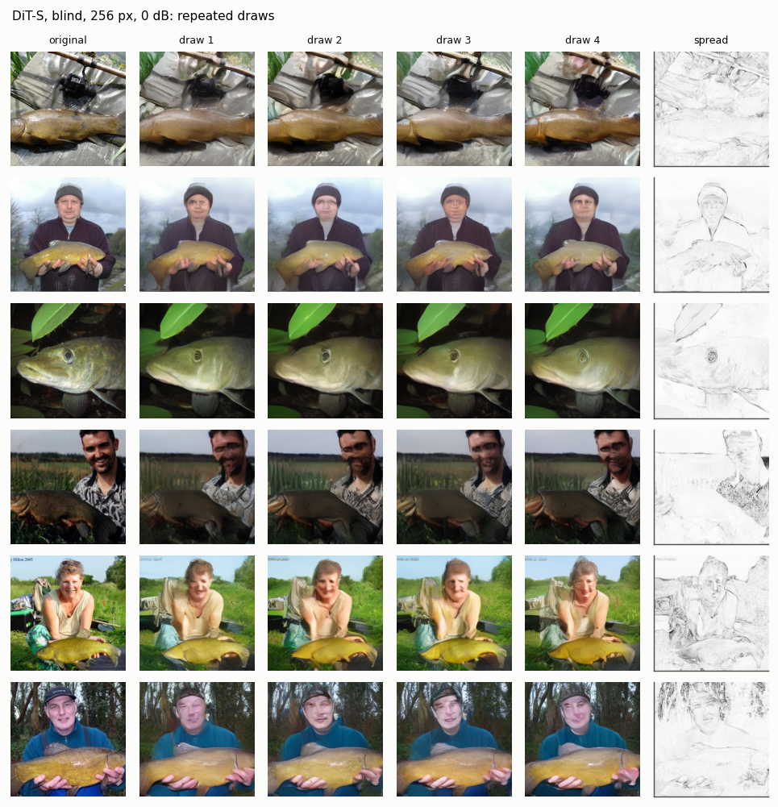

## 12. Training

From each run's logs (spec `logs`, in order; resumed runs merged) and history.json. The diffusion loss of the generative systems and the CNN's pixel loss are different quantities: compare loss within a family only.

Training loss is logged every 100 steps (mean over those steps); validation uses the EMA weights: loss on the validation split, quality on 32 fixed validation images (noisy: compare trends, not single points). Loss jitter = standard deviation / mean of the logged training loss over 2k-step windows.

| Run | Steps | State | Lowest val loss (step) | Last val loss | Validations since a 0.2% gain | Loss jitter, last 10k | Grad norm, last 10k | AMP-skipped | Val DINOv2 @0 dB (best / last) |
|---|---|---|---|---|---|---|---|---|---|
| CNN, MSE+LPIPS, blind, 256 px | 10,000 | finished | 0.0490 (10,000) | 0.0490 | 0 (since 10,000) | 1.1% | 0.087 | 2 | 0.615 / 0.615 |
| DiT-S, blind, 256 px | 140,000 | finished, converged | 0.2840 (140,000) | 0.2840 | 10 of 10 (since 120,000) | 0.8% | 0.158 | 51 | 0.664 / 0.664 |
| CNN, MSE only (stage 1), 256 px | 40,000 | finished | 0.0091 (40,000) | 0.0091 | 0 (since 40,000) | 0.6% | 0.038 | 13 | 0.410 / 0.410 |

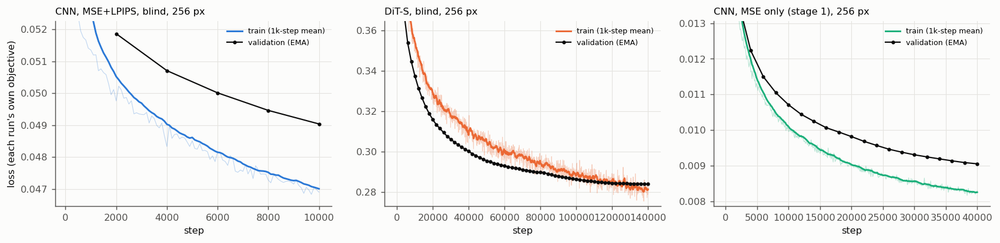

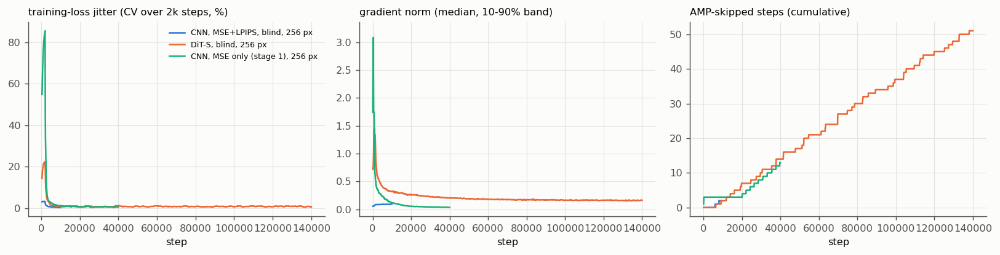

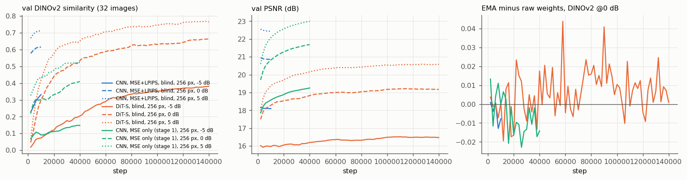

Line style is the SNR (solid / dashed / dotted = -5 / 0 / 5 dB). Above zero in the right panel, the EMA weights the run is evaluated with beat its raw weights.

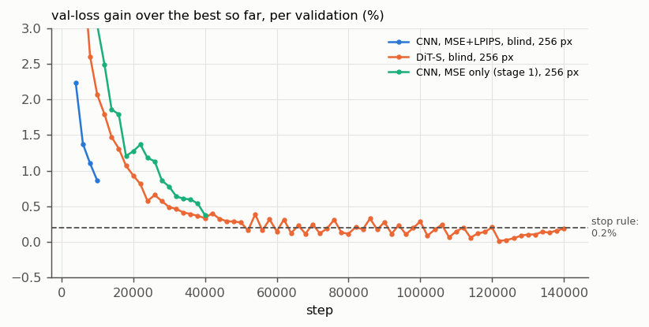

A run stops once `patience` validations in a row stay under the dashed line (no gain above 0.2% over its best). Points near the line mean it is still improving slowly.

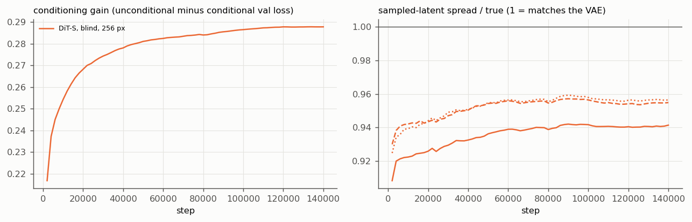

**DiT-S, blind, 256 px**: validation samples over training. In each block the top row is the original, then one row per validation SNR, low to high. These are the trainer's 8 fixed validation images (the first ones of the validation split, so mostly one class); the class-spread images are in section 7.

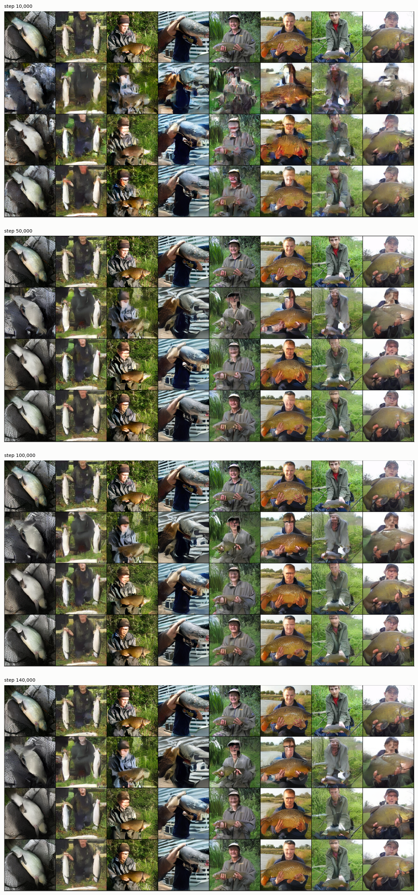
