# Analysis: Week 1, 16-QAM: DiT recipe (option A) and CNN + diffusion refiner (option B) against the blind perceptual CNN

Reference: **CNN, MSE+LPIPS, blind** (`results\gen\p128-perc\cnn_cbr48_qam16_blind-5to5_lpips0.1_ft_s0`). Test set: the 1,000 class-spread test images, 10 sampling steps, paired channel and sampling noise; all runs scored on the same GPU type.

| Key | System | Run |
|---|---|---|
| cnn | CNN, MSE+LPIPS, blind | `results\gen\p128-perc\cnn_cbr48_qam16_blind-5to5_lpips0.1_ft_s0` |
| dit | DiT, blind (baseline) | `results\gen\p128-qam-es\dit-S-v_cbr48_qam16_blind-5to5_s0` |
| a1 | A1 DiT, cosine LR | `results\gen\p128-w1\dit-S-v_cbr48_qam16_blind-5to5_cos_s0` |
| a2 | A2 DiT, cosine + regression | `results\gen\p128-w1\dit-S-v_cbr48_qam16_blind-5to5_cos_reg1_s0` |
| a3 | A3 DiT, cosine + REPA | `results\gen\p128-w1\dit-S-v_cbr48_qam16_blind-5to5_cos_repa0.5_s0` |
| b1 | B1 CNN + diffusion refiner | `results\gen\p128-ref\ref-S-v_cbr48_qam16_blind-5to5_cos_s0` |

## 1. Verdict against the pre-registered rule

Rule fixed on 17 Nov before any result: a candidate **beats the reference** if, at 0 and +5 dB, it has a clear gain on LPIPS (95% interval below 0) or on FID (more than 5 points lower), and no clear loss (interval entirely on the wrong side) on DINOv2 similarity or retrieval top-1. Between candidates that pass, the higher DINOv2 similarity wins.

| Candidate | 0 dB: perceptual gain / semantic loss | 5 dB: perceptual gain / semantic loss | Verdict |
|---|---|---|---|
| DiT, blind (baseline) | yes / yes | yes / yes | does not pass |
| A1 DiT, cosine LR | no / yes | yes / yes | does not pass |
| A2 DiT, cosine + regression | no / yes | yes / yes | does not pass |
| A3 DiT, cosine + REPA | no / yes | yes / yes | does not pass |
| B1 CNN + diffusion refiner | no data | no data | does not pass |

## 2. Metrics against SNR

Means over the 1,000 images. FID uses 1,000 images (relative only). Class kept: DINOv2 10-NN classifier on the reconstructions (from the dump).

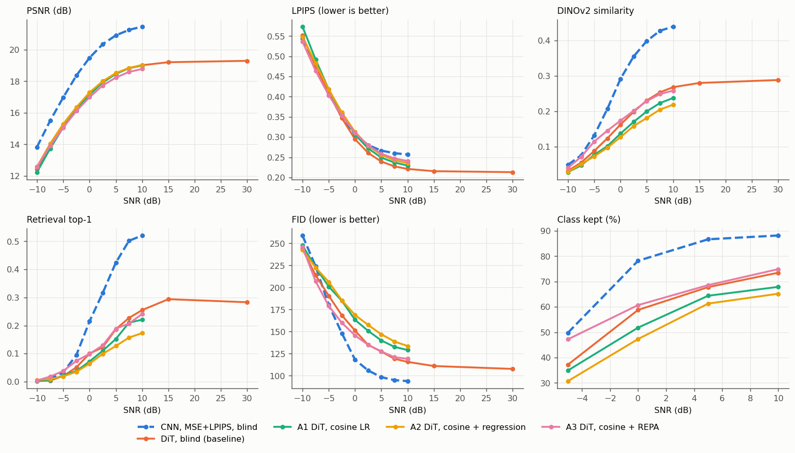

| SNR | System | PSNR | LPIPS | DINOv2 | Top-1 | FID | Class kept |
|---|---|---|---|---|---|---|---|
| -10 | CNN, MSE+LPIPS, blind | 13.83 | 0.544 | 0.049 | 0% | 259 |  |
| -10 | DiT, blind (baseline) | 12.41 | 0.551 | 0.032 | 0% | 244 |  |
| -10 | A1 DiT, cosine LR | 12.24 | 0.574 | 0.028 | 0% | 248 |  |
| -10 | A2 DiT, cosine + regression | 12.57 | 0.549 | 0.029 | 1% | 243 |  |
| -10 | A3 DiT, cosine + REPA | 12.58 | 0.537 | 0.040 | 0% | 246 |  |
| -7.5 | CNN, MSE+LPIPS, blind | 15.49 | 0.479 | 0.076 | 1% | 224 |  |
| -7.5 | DiT, blind (baseline) | 13.83 | 0.475 | 0.055 | 0% | 214 |  |
| -7.5 | A1 DiT, cosine LR | 13.73 | 0.492 | 0.047 | 0% | 223 |  |
| -7.5 | A2 DiT, cosine + regression | 14.04 | 0.483 | 0.051 | 1% | 223 |  |
| -7.5 | A3 DiT, cosine + REPA | 13.90 | 0.464 | 0.071 | 2% | 207 |  |
| -5 | CNN, MSE+LPIPS, blind | 16.98 | 0.410 | 0.132 | 3% | 180 | 50% |
| -5 | DiT, blind (baseline) | 15.09 | 0.409 | 0.088 | 2% | 191 | 37% |
| -5 | A1 DiT, cosine LR | 15.08 | 0.418 | 0.077 | 2% | 201 | 35% |
| -5 | A2 DiT, cosine + regression | 15.29 | 0.418 | 0.073 | 2% | 206 | 31% |
| -5 | A3 DiT, cosine + REPA | 15.06 | 0.404 | 0.115 | 4% | 179 | 47% |
| -2.5 | CNN, MSE+LPIPS, blind | 18.36 | 0.349 | 0.207 | 9% | 148 |  |
| -2.5 | DiT, blind (baseline) | 16.26 | 0.347 | 0.124 | 5% | 168 |  |
| -2.5 | A1 DiT, cosine LR | 16.21 | 0.358 | 0.102 | 4% | 185 |  |
| -2.5 | A2 DiT, cosine + regression | 16.35 | 0.361 | 0.097 | 4% | 185 |  |
| -2.5 | A3 DiT, cosine + REPA | 16.12 | 0.353 | 0.146 | 7% | 160 |  |
| 0 | CNN, MSE+LPIPS, blind | 19.49 | 0.306 | 0.292 | 22% | 118 | 78% |
| 0 | DiT, blind (baseline) | 17.25 | 0.295 | 0.163 | 10% | 151 | 59% |
| 0 | A1 DiT, cosine LR | 17.16 | 0.306 | 0.137 | 7% | 163 | 52% |
| 0 | A2 DiT, cosine + regression | 17.29 | 0.313 | 0.127 | 6% | 169 | 47% |
| 0 | A3 DiT, cosine + REPA | 16.99 | 0.310 | 0.174 | 10% | 146 | 61% |
| 2.5 | CNN, MSE+LPIPS, blind | 20.35 | 0.280 | 0.355 | 32% | 106 |  |
| 2.5 | DiT, blind (baseline) | 17.98 | 0.261 | 0.198 | 12% | 135 |  |
| 2.5 | A1 DiT, cosine LR | 17.92 | 0.272 | 0.170 | 11% | 151 |  |
| 2.5 | A2 DiT, cosine + regression | 18.00 | 0.278 | 0.158 | 10% | 158 |  |
| 2.5 | A3 DiT, cosine + REPA | 17.73 | 0.280 | 0.201 | 13% | 135 |  |
| 5 | CNN, MSE+LPIPS, blind | 20.91 | 0.266 | 0.398 | 42% | 98 | 87% |
| 5 | DiT, blind (baseline) | 18.50 | 0.239 | 0.231 | 19% | 127 | 68% |
| 5 | A1 DiT, cosine LR | 18.46 | 0.249 | 0.200 | 15% | 140 | 64% |
| 5 | A2 DiT, cosine + regression | 18.52 | 0.256 | 0.181 | 13% | 147 | 61% |
| 5 | A3 DiT, cosine + REPA | 18.23 | 0.259 | 0.229 | 19% | 127 | 69% |
| 7.5 | CNN, MSE+LPIPS, blind | 21.25 | 0.260 | 0.427 | 50% | 95 |  |
| 7.5 | DiT, blind (baseline) | 18.84 | 0.227 | 0.253 | 23% | 119 |  |
| 7.5 | A1 DiT, cosine LR | 18.82 | 0.237 | 0.223 | 21% | 133 |  |
| 7.5 | A2 DiT, cosine + regression | 18.84 | 0.242 | 0.205 | 16% | 139 |  |
| 7.5 | A3 DiT, cosine + REPA | 18.59 | 0.247 | 0.248 | 21% | 121 |  |
| 10 | CNN, MSE+LPIPS, blind | 21.47 | 0.257 | 0.439 | 52% | 94 | 88% |
| 10 | DiT, blind (baseline) | 19.02 | 0.221 | 0.268 | 25% | 116 | 74% |
| 10 | A1 DiT, cosine LR | 18.99 | 0.230 | 0.237 | 22% | 129 | 68% |
| 10 | A2 DiT, cosine + regression | 19.03 | 0.236 | 0.219 | 17% | 134 | 65% |
| 10 | A3 DiT, cosine + REPA | 18.78 | 0.241 | 0.258 | 24% | 119 | 75% |
| 15 | DiT, blind (baseline) | 19.21 | 0.216 | 0.280 | 29% | 111 |  |
| 30 | DiT, blind (baseline) | 19.29 | 0.213 | 0.288 | 28% | 108 |  |

## 3. Paired differences against the reference

Candidate minus reference per image, mean with 95% bootstrap interval; **bold** = clear gain, *italic* = clear loss. Win rate: share of images where the candidate is better.

| Candidate | SNR | ΔPSNR (dB) | ΔLPIPS | ΔDINOv2 | ΔTop-1 (pts) | ΔTop-5 (pts) | Win rate PSNR / LPIPS / DINOv2 |
|---|---|---|---|---|---|---|---|
| DiT, blind (baseline) | -5 | *-1.89 [-1.96, -1.81]* | -0.001 [-0.004, +0.003] | *-0.044 [-0.051, -0.038]* | *-1.3 [-2.6, -0.1]* | -2.1 [-4.2, +0.0] | 4% / 51% / 34% |
| DiT, blind (baseline) | 0 | *-2.23 [-2.28, -2.18]* | **-0.011 [-0.014, -0.008]** | *-0.129 [-0.139, -0.119]* | *-11.5 [-14.4, -8.7]* | *-21.0 [-24.3, -17.3]* | 1% / 59% / 19% |
| DiT, blind (baseline) | 5 | *-2.41 [-2.47, -2.36]* | **-0.027 [-0.030, -0.024]** | *-0.168 [-0.178, -0.157]* | *-23.7 [-27.1, -20.3]* | *-28.9 [-32.6, -25.2]* | 1% / 75% / 15% |
| A1 DiT, cosine LR | -5 | *-1.90 [-1.97, -1.82]* | *+0.008 [+0.004, +0.012]* | *-0.055 [-0.062, -0.048]* | -1.1 [-2.4, +0.2] | *-3.3 [-5.4, -1.2]* | 5% / 44% / 31% |
| A1 DiT, cosine LR | 0 | *-2.33 [-2.39, -2.28]* | +0.000 [-0.003, +0.004] | *-0.155 [-0.165, -0.145]* | *-14.3 [-16.9, -11.7]* | *-26.0 [-29.5, -22.3]* | 1% / 51% / 16% |
| A1 DiT, cosine LR | 5 | *-2.44 [-2.49, -2.39]* | **-0.017 [-0.020, -0.014]** | *-0.198 [-0.208, -0.188]* | *-27.2 [-30.7, -23.8]* | *-34.7 [-38.3, -31.1]* | 1% / 66% / 12% |
| A2 DiT, cosine + regression | -5 | *-1.68 [-1.75, -1.61]* | *+0.008 [+0.004, +0.012]* | *-0.059 [-0.067, -0.053]* | *-1.4 [-2.7, -0.2]* | *-4.9 [-7.1, -2.7]* | 5% / 44% / 28% |
| A2 DiT, cosine + regression | 0 | *-2.20 [-2.25, -2.15]* | *+0.007 [+0.004, +0.010]* | *-0.165 [-0.176, -0.154]* | *-15.1 [-17.8, -12.5]* | *-27.7 [-31.2, -24.2]* | 1% / 44% / 14% |
| A2 DiT, cosine + regression | 5 | *-2.39 [-2.44, -2.34]* | **-0.010 [-0.013, -0.007]** | *-0.217 [-0.228, -0.207]* | *-29.7 [-33.1, -26.4]* | *-40.1 [-43.6, -36.4]* | 1% / 59% / 10% |
| A3 DiT, cosine + REPA | -5 | *-1.91 [-1.99, -1.84]* | **-0.006 [-0.010, -0.002]** | *-0.017 [-0.025, -0.010]* | +0.5 [-1.0, +2.0] | +1.7 [-0.6, +4.1] | 5% / 53% / 44% |
| A3 DiT, cosine + REPA | 0 | *-2.50 [-2.55, -2.45]* | *+0.004 [+0.001, +0.008]* | *-0.118 [-0.129, -0.108]* | *-11.6 [-14.2, -8.7]* | *-19.1 [-22.7, -15.5]* | 1% / 48% / 22% |
| A3 DiT, cosine + REPA | 5 | *-2.68 [-2.73, -2.62]* | **-0.008 [-0.011, -0.005]** | *-0.170 [-0.180, -0.159]* | *-23.5 [-27.0, -20.2]* | *-30.2 [-33.9, -26.4]* | 1% / 58% / 15% |

## 4. Perception-distortion and perception-semantics planes

Each line is one system across SNR (marker size grows with SNR). Down-right is better in both panels: a system that only trades along a line moved along the trade-off, one that moves the whole line beat it.

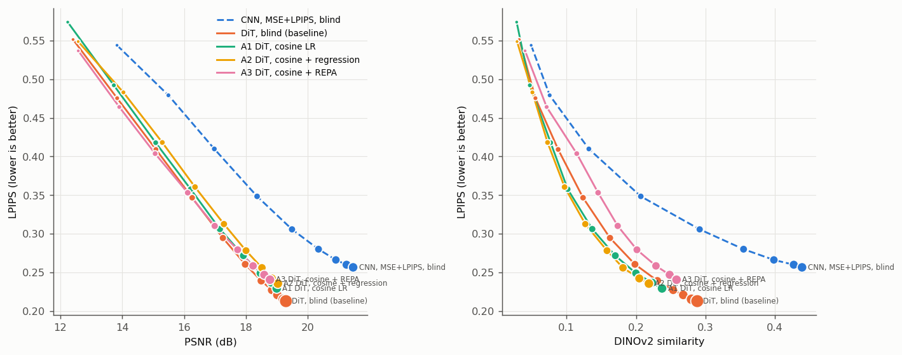

## 5. Per image: does a perceptual gain cost semantics on the same image?

Each dot is one test image: x = ΔLPIPS (left of 0 = sharper / closer perceptually), y = ΔDINOv2 (above 0 = semantically closer), candidate minus reference. The corner shares say how often a candidate wins on both, only perceptually, only semantically, or on neither.

**0 dB**

| Candidate | Both better | Perceptual only | Semantic only | Neither |
|---|---|---|---|---|
| DiT, blind (baseline) | 13% | 47% | 6% | 34% |
| A1 DiT, cosine LR | 10% | 40% | 6% | 44% |
| A2 DiT, cosine + regression | 9% | 36% | 5% | 51% |
| A3 DiT, cosine + REPA | 14% | 34% | 8% | 44% |

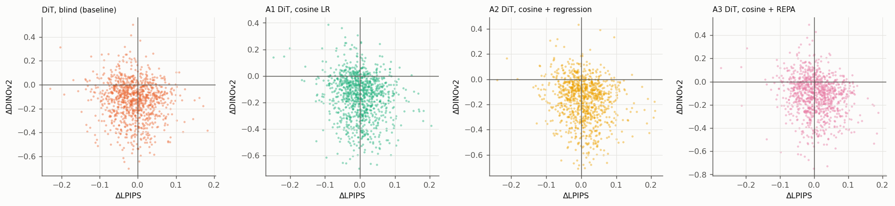

**5 dB**

| Candidate | Both better | Perceptual only | Semantic only | Neither |
|---|---|---|---|---|
| DiT, blind (baseline) | 12% | 63% | 3% | 22% |
| A1 DiT, cosine LR | 10% | 56% | 2% | 32% |
| A2 DiT, cosine + regression | 8% | 51% | 3% | 38% |
| A3 DiT, cosine + REPA | 10% | 48% | 4% | 37% |

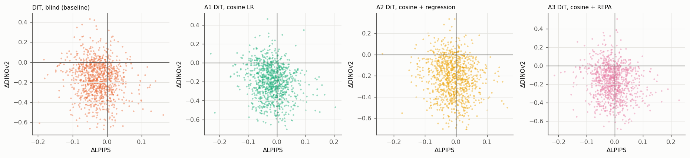

## 6. Class kept per class

DINOv2 10-NN class of each reconstruction against the true class, 1000 images (100 per class on average).

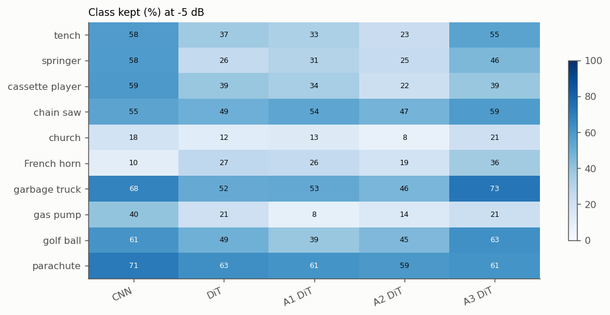

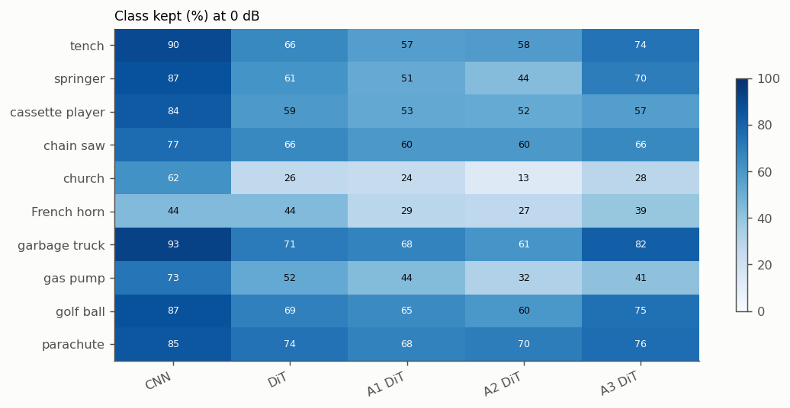

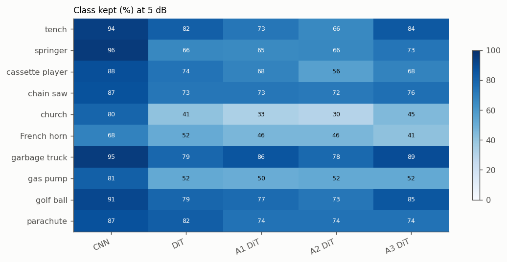

## 7. Images

One test image per class. Under each reconstruction: the class the classifier sees (✓ = true class) and the image's PSNR.

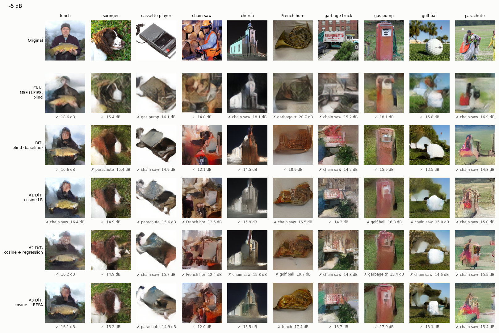

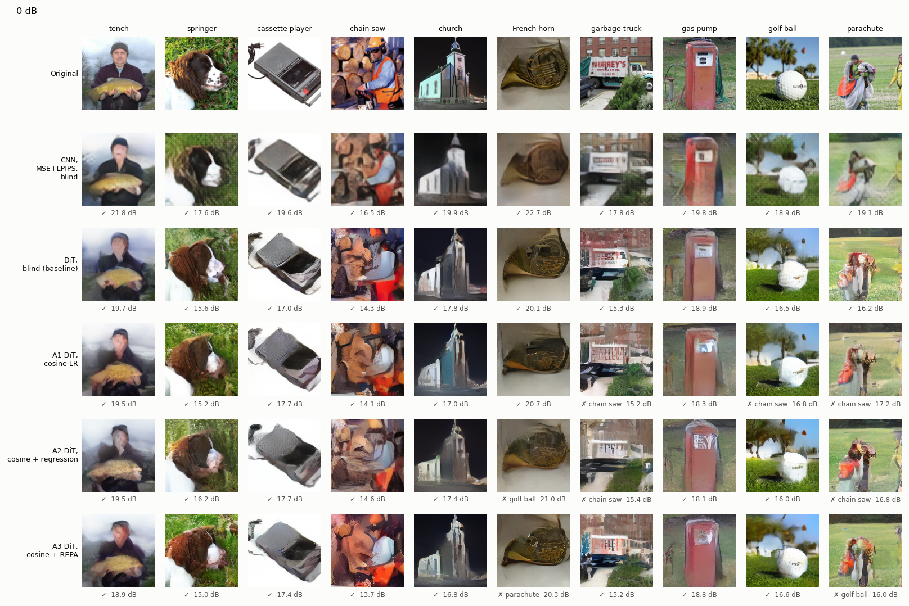

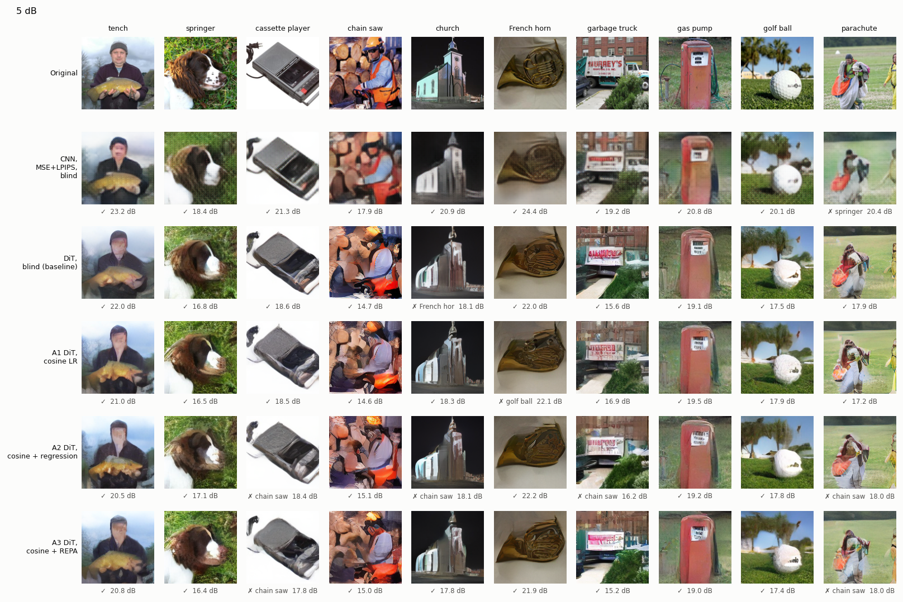

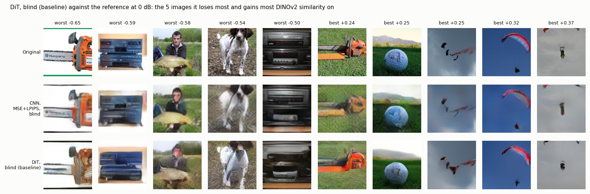

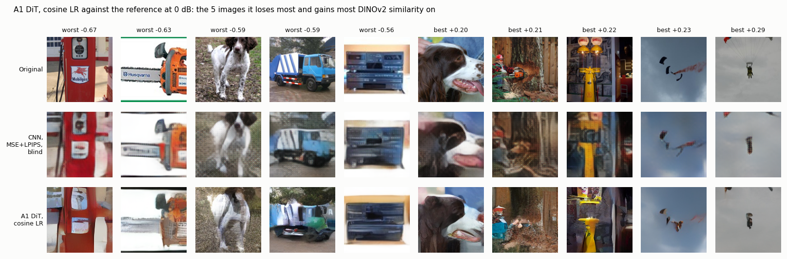

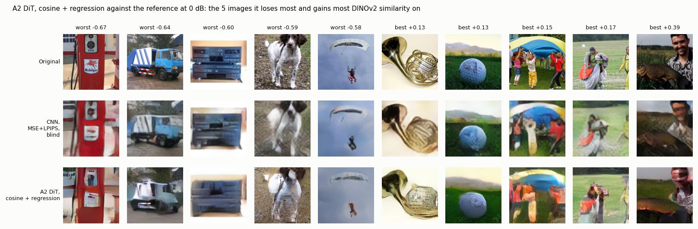

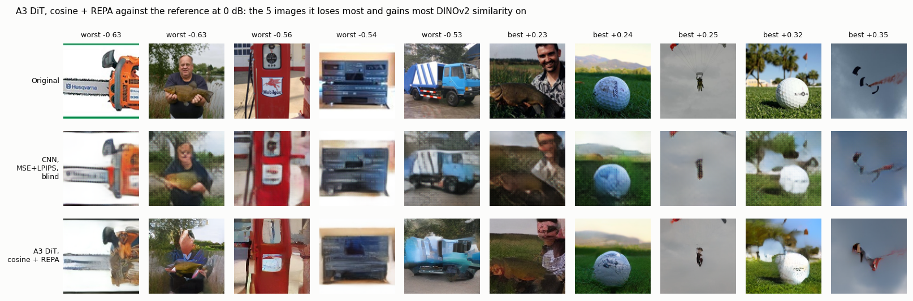

## 8. Power spectrum against the originals

Radially averaged power spectrum of the reconstructions over that of the originals (kept images, grey level). Below 1 at high frequency = blur (detail removed); above 1 = texture or noise added that the original does not have.

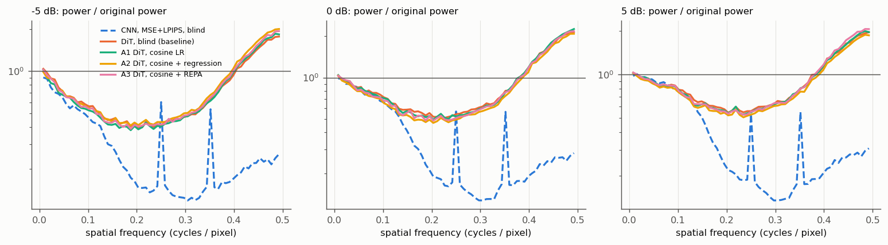

High-frequency power (upper half of the band) relative to the originals:

| System | -5 dB | 0 dB | 5 dB |
|---|---|---|---|
| CNN, MSE+LPIPS, blind | 0.20 | 0.21 | 0.23 |
| DiT, blind (baseline) | 0.90 | 1.12 | 1.08 |
| A1 DiT, cosine LR | 0.92 | 1.13 | 1.08 |
| A2 DiT, cosine + regression | 1.00 | 1.06 | 1.03 |
| A3 DiT, cosine + REPA | 0.95 | 1.11 | 1.11 |

## 9. Image statistics against the originals

Ratios to the original image (1 = same): sharpness = variance of the Laplacian, contrast = pixel standard deviation, saturation = mean HSV saturation; colour shift = mean absolute change of the per-channel means (0-255). Means over the kept images.

| System | SNR | Sharpness | Contrast | Saturation | Colour shift |
|---|---|---|---|---|---|
| CNN, MSE+LPIPS, blind | -5 | 0.15 | 0.85 | 0.78 | 5.6 |
| DiT, blind (baseline) | -5 | 1.04 | 0.93 | 0.94 | 8.7 |
| A1 DiT, cosine LR | -5 | 0.94 | 0.91 | 0.93 | 8.6 |
| A2 DiT, cosine + regression | -5 | 1.16 | 0.92 | 0.96 | 7.5 |
| A3 DiT, cosine + REPA | -5 | 1.07 | 0.93 | 0.96 | 8.9 |
| CNN, MSE+LPIPS, blind | 0 | 0.17 | 0.91 | 0.84 | 3.1 |
| DiT, blind (baseline) | 0 | 1.05 | 0.97 | 0.97 | 5.8 |
| A1 DiT, cosine LR | 0 | 1.16 | 0.96 | 0.97 | 5.5 |
| A2 DiT, cosine + regression | 0 | 1.07 | 0.95 | 0.98 | 5.3 |
| A3 DiT, cosine + REPA | 0 | 1.13 | 0.96 | 1.00 | 5.7 |
| CNN, MSE+LPIPS, blind | 5 | 0.19 | 0.93 | 0.89 | 2.5 |
| DiT, blind (baseline) | 5 | 1.11 | 0.96 | 0.97 | 4.1 |
| A1 DiT, cosine LR | 5 | 1.08 | 0.97 | 0.98 | 4.4 |
| A2 DiT, cosine + regression | 5 | 1.03 | 0.97 | 0.99 | 3.4 |
| A3 DiT, cosine + REPA | 5 | 1.09 | 0.97 | 1.00 | 4.6 |

(Sharpness, contrast and saturation are medians of per-image ratios.)

## 10. Sample diversity

The same received symbols decoded several times with different sampling noise. Spread = per-pixel standard deviation across draws (0-255), averaged; draw-to-draw PSNR = between two draws of the same image. A deterministic receiver has spread 0. High spread at high SNR means the receiver invents content the channel does carry.

| System | SNR | Spread | Draw-to-draw PSNR (dB) |
|---|---|---|---|
| DiT, blind (baseline) | -5 | 19.7 | 16.5 |
| DiT, blind (baseline) | 0 | 13.8 | 19.3 |
| DiT, blind (baseline) | 5 | 11.8 | 20.6 |
| DiT, blind (baseline) | 10 | 11.2 | 21.0 |
| A1 DiT, cosine LR | -5 | 20.0 | 16.5 |
| A1 DiT, cosine LR | 0 | 14.0 | 19.3 |
| A1 DiT, cosine LR | 5 | 11.8 | 20.6 |
| A1 DiT, cosine LR | 10 | 11.2 | 21.0 |
| A2 DiT, cosine + regression | -5 | 18.9 | 17.0 |
| A2 DiT, cosine + regression | 0 | 13.8 | 19.3 |
| A2 DiT, cosine + regression | 5 | 11.6 | 20.7 |
| A2 DiT, cosine + regression | 10 | 11.0 | 21.0 |
| A3 DiT, cosine + REPA | -5 | 19.2 | 16.7 |
| A3 DiT, cosine + REPA | 0 | 14.5 | 18.9 |
| A3 DiT, cosine + REPA | 5 | 12.4 | 20.2 |
| A3 DiT, cosine + REPA | 10 | 11.9 | 20.4 |

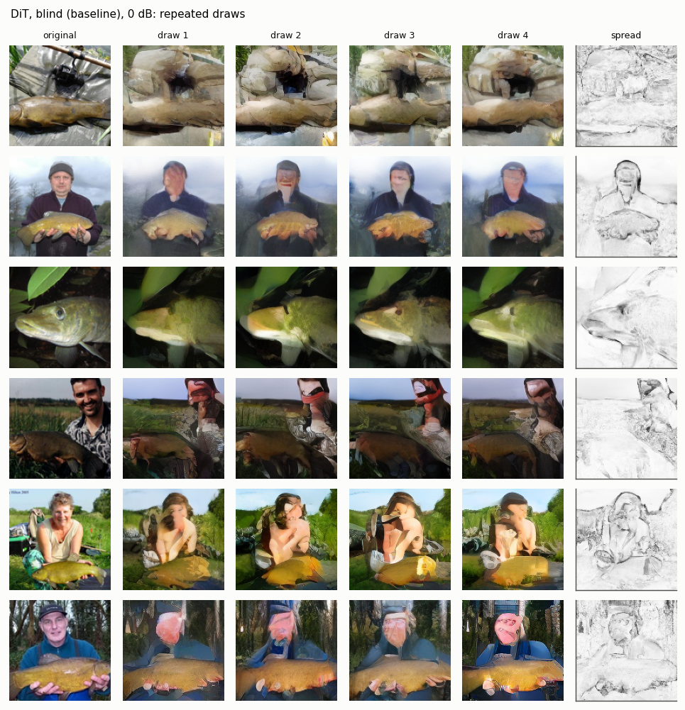

## 12. Training

Validation curves from each run's history.json (EMA weights). The diffusion loss of the generative systems and the CNN's pixel MSE are different quantities: compare loss within a family only.

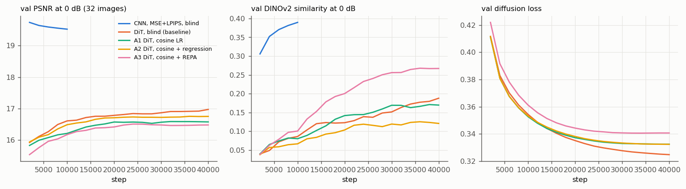
